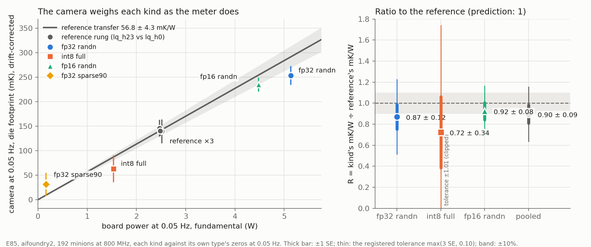

# E85 data: the thermal camera's view of different kinds of numbers (Q130, Sat 31 Oct 2026, aifoundry2)

One card session of [`tools/claims-v3/hlk`](../../../../tools/claims-v3/hlk/README.md), 15:54:17–16:36:18 PDT,
`protocol-e85.json` as pre-registered in `8b441fd9` (pushed 15:52:32, before the `#community-lab` claim at 15:53:52
and the operand check at 15:54:15): 192 minions (E63 A1's geometry), each kind switched against its own type's
zeros at 0.05 Hz, E63's reference rung three times. **240 launches, 42.0 card-minutes** (plus the 2 s operand check),
`stop_reason done`, none failed. The raw frames (2.73 GB, the camera's lossless stream with the host's receive time
on every frame) stay on aifoundry2, gitignored, as E62's, E63's and E73's do; [`left-on-aifoundry2.sha256`](left-on-aifoundry2.sha256)
lists them.

**Nothing on the card or the camera was changed.** `ettelem config`, read only, under the card lock with `timeout 10`:
`tdp_w 65, temp_threshold_c 65, low_power, minion 600 MHz / 519 mV` at 15:54:15 and again at 16:36:20
([`pre/`](pre/)). No governor, clock, PMIC, reset, PCIe, driver or firmware command is part of E85. The runner held the
card lock for the whole session, every launch ran under `timeout 10`, `et-who` was empty before and after, and nobody
else was logged in. The camera stayed on preset `visualize` with its automatic shutter on.



## RESULTS

**1. The camera weighs fp32 and fp16 random data as the meter does.** Each kind against its own zeros, 192 minions
at 800 MHz, the ROI (the die's footprint, the warm quarter of E62's bloom map) at 0.05 Hz
([`analysis/score.txt`](analysis/score.txt), [`analysis/lockin.json`](analysis/lockin.json) `blocks`):

| block | arm A vs arm B | camera at 0.05 Hz, mK | p | board step, W | board fundamental, W | H, mK/W | lag |
|---|---|---|---|---|---|---|---|
| E85-REF1 | lq_h23 vs lq_h0 | 151.0 ± 26.0 | 7 × 10⁻⁴ | 4.028 ± 0.021 | 2.518 | 59.96 ± 9.38 | 102.5° |
| **E85-F32** | **fp32 randn vs fp32 zeros** | **267.6 ± 19.9** | 9 × 10⁻⁵ (floor) | **8.316 ± 0.013** | 5.135 | **52.10 ± 3.82** | 92.7° |
| E85-I8 | int8 full vs int8 zeros | 64.5 ± 28.3 | 0.054 | 2.450 ± 0.008 | 1.534 | 42.07 ± 19.27 | 109.4° |
| E85-REF2 | lq_h23 vs lq_h0 | 145.0 ± 17.0 | 0.0017 | 4.021 ± 0.011 | 2.468 | 58.76 ± 7.85 | 95.1° |
| **E85-F16** | **fp16 randn vs fp16 zeros** | **227.0 ± 13.6** | 1.5 × 10⁻⁴ | **7.466 ± 0.009** | 4.477 | **50.72 ± 3.21** | 97.2° |
| E85-SP90 | fp32 sparse90 vs fp32 zeros | 29.4 ± 22.3 | 0.57 | 0.236 ± 0.008 | 0.165 | — | — |
| E85-REF3 | lq_h23 vs lq_h0 | 128.5 ± 9.3 | 7 × 10⁻⁴ | 4.029 ± 0.019 | 2.481 | 51.79 ± 3.50 | 98.5° |

Camera amplitudes are the 0.05 Hz component's magnitude ± its SE over laps (along its own phase); p is the sign-flip
p over whole laps; H is the camera fundamental over the board's own fundamental, ± its lap jackknife SE of |H|; the
lag is H's phase. The reference blocks drift as E63's did, **59.96 → 58.76 → 51.79 mK/W**, a line of **56.76 ± 4.27
mK/W at the session's mid-time, −29.4%/h**, phase 98.8 ± 4.1°, χ² 0.12/1 ([`analysis/score.json`](analysis/score.json)
`reference_line`).

**2. Against the drift-corrected reference, the ratio is 1 within the design's resolution.** R = |H_kind| / Href(t)
([`analysis/score.json`](analysis/score.json) `kinds`, `rules`):

| kind | R (SE: own, line) | lag − reference | camera-read step | meter's step | mK per W of step |
|---|---|---|---|---|---|
| fp32 randn | **0.869 ± 0.118** (0.064, 0.099) | −6.2 ± 6.2° | 7.22 ± 0.99 W | 8.316 W | 32.2 |
| int8 full | 0.723 ± 0.338 (0.331, 0.066) | +10.6 ± 13.5° | 1.80 ± 0.81 W | 2.450 W | 26.3 |
| fp16 randn | **0.923 ± 0.080** (0.058, 0.055) | −1.7 ± 4.7° | 6.68 ± 0.57 W | 7.466 W | 30.4 |
| pooled (three) | **0.895 ± 0.086** (0.043, 0.075) | | | | |

The camera-read step is the kind's camera fundamental through Href(t) and the session's own fundamental per watt of
step, read back as watts. The pooled ratio is 1.2 SE below 1. fp32 and fp16 random data warm the back of the board
with the reference rung's lag, within 6° and 2°: the heat comes from the same place by the same path.

**3. int8 full was not detected at the registered bar.** 64.5 ± 28.3 mK, sign-flip p 0.054 (E85-R1 needs p < 0.001),
SNR 2.3, against 86 mK predicted. Its board step was clean (2.450 ± 0.008 W). The camera was noisy in that block:
the automatic shutter fired **58 times in its 18 analysed laps** (3.2 a lap, against 1.7–2.1 in F32 and F16), so only
470 of its 720 bins survived the shutter guards, in 33 stretches, and its per-lap amplitudes scatter by about 120 mK
against 60–90 in F32 and F16 ([`analysis/lockin.json`](analysis/lockin.json) `blocks.E85-I8.ffc`, `bins_kept`,
`per_lap`). Its ratio, 0.72 ± 0.34, is consistent with 1 and resolves nothing.

**4. The near-null kind reads as near-null.** fp32 sparse90 adds 0.236 W at 192 minions; the camera reads 29.4 ± 22.3
mK (p 0.57), 25.0 ± 24.8 mK along the reference direction against 8.8 mK expected from its own watts (E85-R5 PASS).
As the meter says, data that is 90% zeros barely heats the chip.

**5. The board's steps.** All seven inside their frozen bands. The reference rung stepped **4.028, 4.021 and 4.029 W**
(the earlier five 192-minion blocks averaged 4.022). The kinds came in 6–14% under the full-card first-second powers
scaled by 192/1024: fp32 randn 8.316 W (predicted 9.125), fp16 randn 7.466 (7.938), int8 full 2.450 (2.640), fp32
sparse90 0.236 (0.274); as full-card equivalents (× 1024/192) 44.35, 39.82, 13.07 and 1.26 W against E80/E83's
p800 differences of 48.66, 42.34, 14.08 and 1.46 W (`kinds.*.board_step_full_card_equiv_w`). The arms' steady
levels: fp32 zeros 31.74 W, fp16 zeros 31.59, int8 zeros 31.30, against fp32 randn 40.05, fp16 randn 39.04, int8 full
33.77 (`blocks.*.arm_board_w`).

**6. Hold.** Every block held: 97.8–99.95% of the in-launch samples from 1.5 s at ≥ 790 MHz, die mean 53.5–56.2 °C,
max 57.3 °C. 29 of 240 launches carried a sub-790 MHz excursion after 1.5 s ([`analysis/dips.json`](analysis/dips.json)):
6 mid-launch idle-reset dips (onsets 3.2–7.2 s, 1.2–1.5 s long, to 600 MHz through 700, the SRAM rail at 704–734 mV:
E63's signature) and 23 that begin within 0.1 s of the 1.5 s mark, 19 of them a single 700 MHz sample (the launch's
own ramp from 600 MHz finishing late) and 4 lasting 0.8–3.8 s; loaded and quiet arms 14 and 15. E73 had 9 of 248. The board power that feeds every H is measured through them.

**7. The camera and the scene.** 63,003 packets at 24.9997 fps over 2,520 s, 0 gaps, 0 reconnects, 0 partial frames
([`session/cam/done.json`](session/cam/done.json)); 283 shutter events, every stretch between two given its own offset,
nothing bridged. The view had not moved since E62: (−1, −1) full-resolution pixels, (0, 0) binned, peak correlation
0.97, template kept. The in-phase maps carry the bloom's shape (r 0.51–0.55 with E62's bloom map, 0.68–0.73
high-passed; sparse90's near-null map 0.30 / 0.50). The shutter's phase against the drive: Rayleigh p 0.02–0.98 (one
block of seven under 0.05, REF1 at 0.022; none under 0.01). The focal plane's thermistor carries nothing at 0.05 Hz
(p 0.22–0.96).

## What was registered and what happened

| rule | registered bar | measured | verdict |
|---|---|---|---|
| E85-R1 seen | p < 0.001 and lag in (0°, 180°) | F32 p 9 × 10⁻⁵, 92.7°; F16 1.5 × 10⁻⁴, 97.2°; **I8 p 0.054**, 109.4° | F32 PASS, F16 PASS, **I8 FAIL** |
| E85-R2 heat follows watts | \|R − 1\| ≤ max(3 SE, 0.10) | F32 0.869 ± 0.118 (tol 0.354); I8 0.723 ± 0.338 (tol 1.014); F16 0.923 ± 0.080 (tol 0.241) | PASS ×3 |
| E85-R3 pooled | \|R − 1\| ≤ max(3 SE, 0.05) | 0.895 ± 0.086 (tol 0.259) | PASS |
| E85-R4 same lag | within max(3 SE, 15°) | −6.2 ± 6.2°, +10.6 ± 13.5°, −1.7 ± 4.7° | PASS ×3 |
| E85-R5 near-null | within 3 SE of Href × its W | 25.0 ± 24.8 against 8.8 mK | PASS |
| E85-R6 electrical | each step inside its band | 7 of 7 (kinds 6–14% under the point) | PASS ×7 |
| E85-R7 reference line | worst residual ≤ 3 SE | 0.29 SE, χ² 0.12/1 | PASS |
| E85-R8 hold | ≥ 95% at ≥ 790 MHz, die mean < 65 °C | 97.8–99.95%, 53.5–56.2 °C | PASS ×7 |
| E85-R9 absolute | inside E63's mK/W band × predicted W | 267.6 in 191–482; 64.5 in 55–139; 227.0 in 166–419 | PASS ×3 |

So 8 of the 9 rules pass in full, and R1 passes for fp32 and fp16 but fails for int8. Read with the resolution said
before the data: R2 can catch a departure of about 25–35% for fp32 and fp16 here (the tolerances were 0.35 and 0.24)
and nothing for int8, and the pooled R3 about 26%. A PASS means "equal within those bounds".

## Post hoc, with no verdict

Everything below came after the data and moves no verdict.

1. **The analysis reads R a little low, and its SE is a little small.** Twenty more synthetic seeds of
   [`selftest_hlk.py`](../../../../tools/claims-v3/hlk/selftest_hlk.py) (seeds 91–110, the registered design, the
   camera's gain drifting 60 → 45 over the session, R = 1 planted for F32 and F16 and 2 for I8) gave a mean R over
   planted of **0.963 ± 0.025 (F32), 0.947 ± 0.021 (F16) and 0.976 ± 0.023 (I8)**, and the 60 ratio z-scores an sd of
   1.30 (1.13 without the two largest): 85% inside 2 SE, 95% inside 3. In 3 of the 40 R = 1 cases R2 failed
   (recovered 0.75–0.78 with SEs of 0.06–0.07). The six seeds run before the freeze had said z sd 0.90. On that
   evidence the measured pooled 0.895 ± 0.086 sits about 0.93 after the synthetic's ~4% shortfall, and its SE is
   likely 15–30% too small; neither changes what the data say: equal within about 25%. Where the shortfall comes
   from (the reference line's interpolation, the |H| ratio, or the synthetic itself) is not resolved.
   [`posthoc/selftest-20-seeds.txt`](posthoc/selftest-20-seeds.txt).
2. **Why int8 was noisy**: the shutter (result 3). E63's automatic-shutter rate was 2.8–10.7 a minute by block; here I8
   ran at 9.7 a minute (SP90 10.8, REF2 8.8), F32 and F16 at 6.4 and 5.0, REF1 6.3 and REF3 3.3. The shutter triggers on the camera's own drift, and I8 followed F32, the
   session's hottest block: the board was settling ~3 W lower. Nothing in the registered analysis treats it.
3. **The steps sit 6–9% under the full-card scaling for the three main kinds.** E80 and E83's p800 is the board's power
   in the first second at 800 MHz from a die at ≤ 55 °C on all 1,024 minions; E85 runs 192 minions in a steady 0.05 Hz
   alternation at a 54–56 °C die. The same E80/E83 switching terms c, taken through the 800-over-600 MHz voltage
   factor (800/600 × (0.618/0.517)² = 1.905) instead of p800, would have predicted 8.52, 7.64 and 2.34 W, within
   +2.5%, +2.3% and −4.4% of what was measured. The p800 route was the registered one and stays the verdict.

## What this changes

- **For the blog: heat follows the numbers.** An instrument that knows nothing about watts, a thermal camera looking
  at the back of the board, sees random fp32 data warm the die by 268 mK at 0.05 Hz and random fp16 data by 227 mK,
  each against its own zeros, and per watt of the meter's switching power they warm it as E63's bit-flip rung does
  (R = 0.87 ± 0.12 and 0.92 ± 0.08), with the same lag. Sparse data that adds almost no switching shows almost no heat.
  The kinds' power differences are heat in the die, not an artefact of the meter.
- **The kinds table gains a heat column** at 192 minions and 800 MHz on aifoundry2: camera mK at 0.05 Hz and mK per
  watt for fp32 randn and fp16 randn (measured), int8 full (64.5 ± 28.3 mK, not significant) and fp32 sparse90
  (29.4 ± 22.3 mK, consistent with its 0.24 W). These are relative heat signals: no absolute temperature is claimed,
  and E73's heat path (a ~16 s pole plus ~1 s) says 0.05 Hz carries about a fifth of the steady rise.
- **The Horace hub's Levels tab, row "Coda · Back out"**: the camera now weighs kinds of numbers as well as flipped
  bits. What stays open: int8 with enough laps or a quieter shutter, a gain that holds still (−29%/h again here), and
  the ~4% shortfall the synthetic shows in the ratio.

## Departures from the plan

None from the registered design: every block ran in order with its registered laps, and every rule was scored as
frozen. Two notes. (a) The runner's telemetry sampler runs with `--reset-ms 1000`, which is E63's runner unchanged
(E80's `kspeed` runs without it); E85 sits at ~32–40 W, far from the 65 W test that the PMIC's running average feeds.
(b) The dry run staged the hlk files from a pre-commit copy (`HLK_SRC`); after the commit the box fast-forwarded to
`8b441fd9` and restaged from the commit, and all seven staged hlk files were byte-identical to both
([`code/SHA256SUMS`](code/SHA256SUMS)).

## Files

| Path | What |
|---|---|
| `session/` | the runner's record: `session.json` (protocol and code hashes, heater and kernel hashes, git head, caps, stop reason, `et_who`), `protocol.json`, `launches.jsonl` (every launch with its full command line, `--type` included), `phases.jsonl` (the lock-in's laps), `blocks.jsonl`, `marks.jsonl`, `run.log`, the telemetry `tel.jsonl.gz` (10 Hz: board power, rails, clock, shire sensors) and the recorder's `cam/done.json`, `cam/gaps.jsonl` |
| `red/` | from `reduce_hm.py` (E62's, unchanged): `ffc.json` (every shutter event), `meta.json`, `scene.npy`; `fpa.npz` from `fpa_trace.py` |
| `analysis/` | `lockin_hlk.py`: `lockin.json` (per block, E63's `analyse_block` output plus mid-time, hold, dips and arm levels), `score.json` and `score.txt` (the reference line, the kinds, the nine rules), `E85-*-maps.npz` (per pixel, 96 × 128); `dips.json` from `dips_hlc.py` |
| `pre/` | `ettelem config` at the start and the end, `et-lab-manifest`, `et-who` after; `tiles/` the operand check (`tile_check.json`: all nine sets byte for byte, cycles per op 546 for fp32 and fp16, 318 for int8; the dumps' sha256) |
| `dry/` | the dry run's `run.log`, the recorder's record and `score.txt` (no card; its electrical rules fail by design) |
| `code/SHA256SUMS` | the staged code directory's hashes |
| `posthoc/` | the 20-seed synthetic check (post hoc result 1) |
| `heat-follows-the-numbers.png` | `figure_e85.py`, from `analysis/` only |
| `left-on-aifoundry2.sha256` | the files left on the box |

## Left on aifoundry2, not committed

Under `build/e85/` of the lab checkout there (`sha256sum -c left-on-aifoundry2.sha256` from the checkout checks them):
`runs/e85-card-1031/cam/cam.p3rec` (the raw stream, 2,726,564,734 bytes), `runs/e85-card-1031-RED/frames.npz` (the
reduced cube, 5,041 bins × 96 × 128, 190,044,741 bytes), the raw telemetry (its gzip is committed), the recorder's
status polls and log, the 480 per-launch logs, and the dry run's stream.

## Rebuild

On aifoundry2 from `build/e85/code/` (`run_e85.sh stage` makes it), or anywhere with numpy and the RED directory:

```bash
bash tools/claims-v3/hlk/run_e85.sh reduce build/e85/runs/e85-card-1031      # reduce_hm, fpa_trace, lockin_hlk, dips
python3 tools/claims-v3/hlk/figure_e85.py <ANA> --out heat-follows-the-numbers.png
python3 tools/claims-v3/hlk/selftest_hlk.py --seed 91 --seeds 20               # post hoc result 1
```
