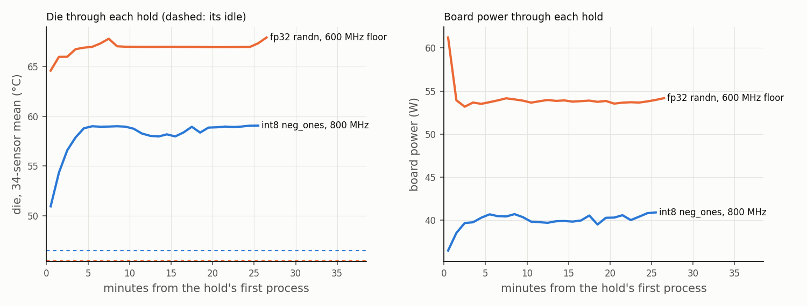

# E111 data: aifoundry2's steady coefficient, a drift probe, and the camera at 0.005 Hz (Q133, Sun 1 Nov 2026)

*On the kinds page, [section 11, what is still open](https://spacesheep.dev/@yaroslavvb/horace-kinds-of-numbers#11-what-is-still-open): item 9, "A
steady state for heat"; item 8, "The heat path drifts between sessions"; and the carried "camera below 0.01 Hz" (E73's result 8, the final
critic's "Not touched").*

*Pre-registered in [`tools/claims-v3/e111/E111.md`](../../../../tools/claims-v3/e111/E111.md) with [`predictions-e111.json`](../../../../tools/claims-v3/e111/predictions-e111.json),
the scorer, its self-test and a full dry run on the box, committed as **`a8e2c969`** at 11:34:55 PST and on origin at 11:34:59 PST. Amendments, each
dated in E111.md: **A1** `620d80d1` (13:53:55, before the claim: an idle login does not block), **A2** `41219a10` (14:43:32, after W1 ended and before
W2: the int8 hold again, from rest, and the camera block last), **A3** `27f2c968` (15:07:20, while W2 ran: the owner's ruling of 1 November 2026 on
idle logins, written on the coordinator's side). Claimed in `#community-lab` at 13:54:47 PST (message `1566571232378359819`); first device access
14:05:00 PST (the smoke's `ettelem config`). Card runs **14:05:00–17:23:46 PST on aifoundry2 card 0 only, 108.8 card-minutes of 120**. TDP 65 W
and threshold 65 °C at all 38 reads; nothing set; the statistics reset only in the camera step (the owner's ruling of 31 October 2026). Released at
17:25–17:26 PST by an edit of the same post.*



## Results first

**23 registered verdicts: 5 PASS, 8 FAIL, 1 OK, 1 ABOVE_TARGET, 5 INCONCLUSIVE, 2 UNDER-RESOLVED, 1 INSIDE.** Six of the eight FAILs were predicted
(the coefficient outside the other cards' and models' bands); **two were not: E111-A1 on both holds, the steadiness test**
([`results.json`](results.json) `tally`, [`reduce.txt`](reduce.txt)). E98's scoring, copied into the scorer, reproduces E98's committed
`results.json` key for key before anything is scored (`e98_regression`).

**1. Item 9: aifoundry2's steady coefficient is about 0.67 °C per board W, the same at 18.6 W and 32.4 W over idle; neither plateau is a steady
state by E97's bar.** One hold per kind, one card, one afternoon ([`results.json`](results.json) `A`):

| hold | kind, clock (share at it) | start | idle before → after: die, W | plateau, last 300 s: die, W | rise | over idle | **c, per board W** [range] | creep, last 10 min: fine W, die | registered |
|---|---|---|---|---|---|---|---|---|---|
| **H-I8** (W1B) | int8 neg_ones, 800 MHz (0.976) | from rest, 26.5 min, 190 of 190 processes | 46.0, 21.935 → 47.0, 22.090 | **59.00 °C, 40.62 W** | 12.50 °C | 18.61 W | **0.672** [0.647, 0.696] | +0.053 W/min (+0.121 °C/min at 0.442 W/°C, se 0.017); die +0.050 °C/min (se 0.016) | A1 **FAIL**; A2 prior **PASS**, lab model FAIL, E97's aifoundry3 FAIL, 76 s line FAIL |
| **H-F32** (W2) | fp32 randn, the 600 MHz floor (1.000) | after E98's probe series and hold, 27.0 min, 190 of 190 | 45.0, 21.705 → 46.0, 21.894 | **67.26 °C, 54.22 W** | 21.76 °C | 32.42 W | **0.671** [0.651, 0.685] | +0.033 W/min (+0.076 °C/min, se 0.034); die +0.071 °C/min (se 0.021) | A1 **FAIL**; A2 as H-I8 |

- **E111-A3 PASS: linear in power.** c(H-F32) / c(H-I8) = **0.999** [0.936, 1.058], inside [0.90, 1.11]. Per board W the leakage's climb sits in
  the denominator, as on aifoundry3 (E97-B3: 0.975).
- **Where 0.67 sits.** Inside the registered band of aifoundry2's near-steady readings, [0.62, 0.82], predicted 0.73; at the low end of those readings
  (the 9 Oct heavy run's 0.68, the camera sessions' 0.695–0.718, E98's 5.5 min holds 0.661–0.719). Wholly below E97's aifoundry3 plateau [0.86, 0.95]
  and the lab model's September 1.47 (each FAIL, as predicted), and wholly above the 76 s line's 0.4573 (FAIL, as predicted): **the 76 s die line's
  slope is about 68% of the steady coefficient** (0.4573 / 0.672).
- **Random fp32 at full duty has a plateau on this card.** The governor holds it at the 600 MHz floor once the die passes 65 °C, so its switching is
  fixed and the die settles: **67.3 °C at 54.2 W, 21.8 °C over a 45.5 °C idle**. On aifoundry3, with no governor, it reached the lab's 78 °C stop in
  221 s (E97). It was predicted at 72.9 °C and 57.1 W for a 47 °C rest die; it read 67.3 °C at 54.2 W over a 45.5 °C idle, the difference mostly
  c (0.67 against 0.73) and the cooler idle.
- **Not a steady state.** Both plateaus still crept over their last 10 minutes, the die by 0.050 and 0.071 °C a minute (0.5 and 0.7 °C, 4% and 3%
  of the rise), so E111-A1 FAILs on both, as two of E97's three holds did. The room warmed late in the afternoon (the idle went 45 → 46 → 47 °C,
  21.705 → 22.090 W, between 14:56 and 17:01). That is in the ranges, and at most about a quarter of the creep: 0.385 W is 1.7 °C of rest die over
  125 minutes, 0.013 °C a minute. On H-I8 the fine W rose more than its die would give at 0.442 W/°C (about 1.07 W per °C of the whole-degree die's slope), so part of its
  W creep is not the die; on H-F32 the two agree (0.47 W/°C). The asymptotes (registered as beside): H-F32 τ 89 s, die 67.20 °C, c 0.670; H-I8's τ sat
  on the grid's lower edge (60 s), so no slow exponential describes its creep ([`results.json`](results.json) `A.*.asymptote`).
- **The inlet proxies beside** (E111-A4, never a verdict). The room's move from each hold's idle mean to its plateau, by the other boxes' 5 s
  history in °C of aifoundry2 rest die: aifoundry1's NIC +0.11 and −0.24, its NVMe 0.0 and −0.24, its card 0 (never held) 0.0 and 0.0, its card 1
  +0.30 and +0.32, aifoundry3's NIC −0.52 and +0.36 (H-I8 and H-F32). **c corrected by each: 0.656–0.700 (H-I8), 0.660–0.679 (H-F32).** The camera
  phone's battery read 30.4–31.4 °C all afternoon, so it says nothing ([`phone.jsonl`](phone.jsonl)).
- *Post hoc* ([`posthoc.txt`](posthoc.txt) §2): **from rest, aifoundry2's die arrives fast.** H-I8 reached 36% of its plateau's rise in its first
  minute, 63% in the 1–2 min bin, 81% in the 2–3 min bin, 91% in the 3–4 min bin and 100% by the 5–6 min bin; aifoundry3's H1 had 45% by 60 s and
  90% by 5 min (E97-B6).

**2. Item 8: the afternoon stayed cool, so no probe was warm; one new probe, on the cool side, fell on E98's line, and its hold did not follow
E98's steep slope (post hoc).** W1 was ended at 14:36:12 by another lab user's fresh login (A1, as written), after its REST and three sustained
runs; W2 ran complete. Probes counted: P1, P3, P6, P7 (E98) and W2 for the line and the hold, with P2 and W1 in the rest die's range
([`results.json`](results.json) `B`):

| rule | verdict | what the data say |
|---|---|---|
| E111-B0, the gate (E98-R0's) | **OK** | five probes for the line, rest-die range 1.54 °C (E98's night alone: 1.01) |
| E111-B1 = E98-R1 on all, the 76 s line on the rest die | **ABOVE_TARGET** | **0.472** [0.371, 0.573] on 3 df (E98's four: 0.502 [0.305, 0.700]) |
| E111-B2 = E98-R2 on all, the hold's die on the rest die | **INCONCLUSIVE** | 1.48 [−0.03, 2.98] (E98's four: 2.19 [0.47, 3.90]) |
| E111-BV = E98-V | **INCONCLUSIVE** | B2 reaches the band and 0.25 |
| E111-B3, does P1's lead repeat? | **UNDER-RESOLVED** ×2 | no warm probe: W2's rest die is 0.66 °C *below* the mean of P3, P6 and P7 |
| E111-B4 = E98-S4, fp16 ones at the trip | **INCONCLUSIVE** ×2 | −11.1 MHz/°C [−23.8, +1.6]; −1.08 W/°C [−2.28, +0.12] |

- **The room did not warm.** From 13:30 to 16:50 aifoundry2's idle card read 21.7–21.95 W and 45–46 °C ([`posthoc.txt`](posthoc.txt) §1),
  below Q132(g)'s nine-day hour means at those hours (22.36 W at 14:00 PDT, 22.76 W at 16:00 PDT). Neither 23 October's 49.3 °C idle die nor any
  warmer probe was reached; the range grew on the cool side only.
- *Post hoc* (§5): **E98's frozen four-probe R1 fit predicted W2's line at 39.017 °C; W2 read 39.072 (+0.055).** A line on the rest die at about
  0.5 °C per °C carries to a probe taken on another day, 0.66 °C cooler than the night's later probes. **Its R2 fit predicted W2's hold at 57.015 °C;
  W2 read 58.268 (+1.25)**, where a slope of 0.25 from the mean of P3, P6 and P7 puts it (58.278); the room's 1.12 puts it at 57.70 (+0.57). One probe,
  against the hold's 0.375 °C scatter a probe.
- Beside the rules: E98's own S3, the run from rest, now on seven probes, reads SUPPORTS on both readings, fine W 1.37 W/W [0.07, 2.67] against
  2.14 and line 0.87 [0.06, 1.69] against 0.89 (on E98's night it was INCONCLUSIVE twice); S1 and S2 read INCONCLUSIVE.

**3. The camera at 0.005 Hz: detected at 18.5 SE, but five laps do not resolve its lag; the session agrees with E73 at 0.025 Hz.** Block E111-F05,
fp32 randn against fp32 zeros on E85's 192 minions, 200 s laps, five analysed ([`CAM-ANA/lockin.json`](CAM-ANA/lockin.json), [`results.json`](results.json) `C`):

| rule | verdict | measured |
|---|---|---|
| E111-C1, detected | **PASS** | ROI fundamental **1,064.9 ± 57.6 mK (18.5 SE)** for a board fundamental of 4.532 W (131 SE); board step 8.58 W; sign-flip p 0.091 (floor 0.0625 at five laps) |
| E111-C2, the lag at 0.005 Hz | **INCONCLUSIVE** | **45.9° ± 14.9°** (lap jackknife), 95% [4.7°, 87.2°] on 4 df, holding 40°; P1D says 28.5° [22.2, 34.3], the slow and diffusive forms 51–63° |
| E111-C3, against E73 at 0.025 Hz | **INSIDE** | the fifth harmonic's lag 74.3° ± 9.4° against E73-F25's 75.6° ± 7.8° (difference −1.3°) |
| E111-C4, the hold | **PASS** | 99.3% of in-launch samples at ≥ 790 MHz; die mean 54.3 °C (max 57.3); 4 of 120 launches carried the idle-reset dip |

- |H(0.005 Hz)| = 235 ± 31 mK/W. The odd harmonics, gain-free against the fundamental: **|H(0.015)| / |H(0.005)| = 0.455** (P1D: 0.619 [0.546, 0.718];
  the slow forms 0.56–0.58), lag 79.6° ± 25.7° at 0.015 Hz; 0.035 Hz 68.5° ± 10.5°, 0.045 Hz 84.2° ± 8.9°.
- *Post hoc* (§4): **E73's 14 points with E111's five under their own gain prefer a slow or distributed part**: P1D χ² 45.1 on 34 dof (AIC 53.1),
  P2 47.0 (55.0), P1D with a slow branch 29.4 on 32 (41.4), P1D with a half-order factor 28.3 on 33 (38.3). That is ΔAIC ≈ 15 against P1D, and the two
  slow forms put 0.005 Hz at 49–51°. Not a verdict, and it leans on E111's five-lap errors.
- *Post hoc* (§3): the die's own transfer at 0.005 Hz in the same block, on its whole-degree reading: **0.350 °C per W of board fundamental, at a 39°
  lag**.

**4. The session** ([`queue.jsonl`](queue.jsonl), [`queue.out`](queue.out), [`queue2.out`](queue2.out), [`chain.out`](chain.out)):

| step | PST | card-min | exit | what |
|---|---|---|---|---|
| SMOKE | 14:05:00–14:05:42 | 0.7 | 0 | E98's smoke |
| W1 | 14:30:00–14:36:12 | 6.2 | **3** | REST and sustained runs 0–2; ended by the other-user check before run 3 |
| W2 | 14:56:13–15:44:19 | 48.1 | 0 | REST, nine sustained runs, E98's hold of 39, H-F32 |
| END | 16:00:03–16:02:04 | 2.0 | 0 | REST: H-F32's idle after; the first queue skipped CAM (A2) and ended |
| W1B | 16:17:03–16:45:42 | 28.7 | 0 | REST, H-I8 from rest (A2) |
| END2 | 17:00:43–17:02:45 | 2.0 | 0 | REST: H-I8's idle after |
| CAM | 17:02:45–17:23:46 | 21.0 | 0 | 0.005 Hz, 120 launches; the camera reduction 17:24:33–17:24:36 on the box's CPU, after the card was done |

## What it changes

- **Item 9, a steady state for heat: narrowed further, not closed.** aifoundry2's coefficient since October's fan work is measured: about **0.67 °C
  per board W** at two operating points, the same within 0.1% (A3 PASS), with inlet proxies beside that move it 0.656–0.700. Random fp32 at full duty
  plateaus on this card (67.3 °C at 54.2 W, at the governor's floor). What stays open: a steady state by the registered bar (both plateaus crept
  0.05–0.07 °C a minute after 26–27 minutes); a replicate of each hold; an inlet thermometer (the proxies are coarse and self-heated).
- **Item 8, the drift: not closed; narrowed in one direction.** No warm probe could be taken (the afternoon stayed below the nine-day means), so
  "more than one warm probe" and "a probe at 23 Oct's idle die" stay open. One cool probe on another day agrees with E98's line, which makes the line's
  dependence on the rest die (about 0.5 °C per °C, registered ABOVE_TARGET on five probes) less likely to be the night's alone; its hold sits where a
  weak dependence puts it, against E98's steep 2.19 (post hoc, one probe).
- **The camera below 0.01 Hz: measured, not resolved.** Detected strongly at 0.005 Hz; the registered lag test is INCONCLUSIVE at five laps. Post hoc the
  combined data lean to a slow or distributed part of the heat path. A longer block (at least ten laps, as E73's 0.01 Hz had) would decide it.
- **The kinds page's section 4 and the hub.** Replace "nobody has measured aifoundry2's steady coefficient since October's cooling change" with this
  measurement; the lab model's 1.47 °C/W and its loop gains are aifoundry2's September fit; on aifoundry2 now the plateau is about 0.67 °C per board W
  and about 68% of it arrives in a 76 s run. aifoundry3's E97 plateau (about 0.9) is another card.

**For the blog.** Once settled, aifoundry2's die sits about 0.67 °C above its idle for every extra watt the board draws, whether the watts come from
int8 constants or random fp32; it gets two thirds of the way in the first minute or two, and it was still creeping slowly after half an hour.

## Registered against what happened

| registered ([`E111.md`](../../../../tools/claims-v3/e111/E111.md)) | happened |
|---|---|
| registration, predictions, scorer and self-test on origin before the claim and any device access | `a8e2c969` on origin 11:34:59; A1 13:53:55; claim 13:54:47; first device access 14:05:00 |
| the smoke from 14:05, W1 from 14:30 (warm afternoon), W2 after 20 min of rest, END after 15 | as such; the afternoon was not warm (§2) |
| W1 = E98's probe ending in a 190-process hold (H-I8) | **ended at 14:36:12 by the other-user rule (exit 3)**; H-I8 came from W1B, the same hold from rest (A2) |
| W2 = E98's probe, its hold of 39, then H-F32 | as such, 190 of 190 processes, the clock at 600 MHz in every plateau sample |
| CAM straight after END | moved after W1B and END2 (A2); ran 120 launches, `stop_reason done` |
| nothing set; config at both ends of every step | 38 reads, all TDP 65 W and threshold 65 °C |
| at most 120 card-minutes; no step after 18:00; hard stop 18:55 | 108.8 card-minutes; last step started 17:02:45; ended 17:23:46 |
| predicted: A1 PASS ×2; A2 prior PASS ×2 and the other bands FAIL ×6; A3 PASS; C1, C3, C4 pass | A1 **FAIL ×2** (not predicted); A2 as predicted ×8; A3 PASS; C1, C3, C4 as predicted |
| predicted c 0.73 (H-I8), 0.72 (H-F32) | 0.672, 0.671: inside the band, 0.06 below the points |

## Departures (dated)

- **A1, A2, A3** are the registration's amendments, each written before the data it touches (E111.md § Amendments).
- **D1 — W1's facts, stated against A2's text (Sun 1 Nov, writing this README).** A2 says W1 was ended "between two launch processes of its fourth
  sustained run" and counts "with three of eight gated runs". From `W1/run.out` and `W1/runs.jsonl`: the check that ended it ran at the start of the
  fourth sustained run, before its first process, and W1 holds runs 0–2, so **two** of the eight gated runs (indexes 1 and 2) plus the run from rest.
  Nothing scored depends on the difference: W1 counts for the rest die only, either way.
- **D2 — W1B waited 15 minutes more than A2's plan (16:02 → 16:17).** E98's rest rule, unchanged, counts rows with the card held as busy, and END
  holds the lock for its REST reading; so W1B's rest ran from END's end. Everything still ended by 17:24.
- **D3 — the camera reduction ran on the box's CPU after the card was done** (17:24:33–17:24:36, at nice 10, as registered), and the claim was released
  after it at 17:25–17:26. No card was in use by anyone then.
- **D4 — the release edit.** The release suffix was appended twice (the post read "— released — released" at 17:25); it was replaced at 17:26 by the
  same text with one "— released" (`edit_replace.mjs`, read back).
- **D5 — the collection ran twice** (17:05, while CAM ran, for a first look at Parts A and B, and 17:27 for all of it), into this directory. Logins a
  runner's mark recorded are replaced with `<another lab user>` (`scrub_logins_e111.py`; ten marks, all in W1's and the queue's records).

## How it ran

On the Intel: `rsync` of `tools/claims-v3/e111/` to aifoundry2's lab checkout (at `0c187e12`, which holds E98's runner, E80's `run_kspeed.py`, E64's
`run_hpl.py`, E63's `run_hlc.py`, the kinds tiles and the binaries E80–E98 ran: `sparsity_host` 7adadf4f…, `sparsity.elf` 990807f4…, `ettelem-hpl`
77a46171…). On aifoundry2, each step in a script file run by `ssh aifoundry2 'bash -s' < file`:

```bash
bash tools/claims-v3/e111/run_e111.sh stage            # build/e111/cam: hlc, hm, hlf + E111's camera protocols and A1's wrapper
bash tools/claims-v3/e111/run_e111.sh check            # host, logins (a count), free space, binaries, card, camera, the plans
bash tools/claims-v3/e111/run_e111.sh dry              # 11:15-11:24: the whole queue with --dry (no device opened)
# 13:54:47 the #community-lab claim (one line)
bash tools/claims-v3/e111/run_e111.sh go 14:30 16:30   # 13:54:57: SMOKE, W1, W2, END, CAM, detached
# 14:40 RUNS/SKIP-CAM (A2); 15:07 watch_activity_e111.py and chain_go2_e111.sh started on the box (A3)
# 16:02:15 chain_go2_e111.sh: run_e111.sh go2 57.09 -> queue_e111.py --steps W1B,END2,CAM
```

Then on the Intel, from the top of the repository:

```bash
bash tools/claims-v3/e111/collect_e111.sh docs/reports/data/2026-11-01-e111-heat-steady 1793568600 1793583000
python3 tools/claims-v3/e111/reduce_e111.py docs/reports/data/2026-11-01-e111-heat-steady \
    --out docs/reports/data/2026-11-01-e111-heat-steady/results.json > docs/reports/data/2026-11-01-e111-heat-steady/reduce.txt
/usr/bin/python3 docs/reports/data/2026-11-01-e111-heat-steady/posthoc_e111.py docs/reports/data/2026-11-01-e111-heat-steady \
    --fig docs/reports/data/2026-11-01-e111-heat-steady/holds.png > docs/reports/data/2026-11-01-e111-heat-steady/posthoc.txt
```

## Joins and traps

- **Per board W, open loop.** c has the leakage's climb in its watts, like E97's "per board W", the lab model's 1.47 and the die line's 0.4573; it is not
  per W of switching. The die is the firmware's whole-degree 34-sensor mean; over 300 s its readings dither enough to read to about 0.1 °C.
- **The two holds started differently.** H-I8 started from rest (W1B); H-F32 straight after E98's probe series and hold of 39, from about 60 °C. So only
  H-I8 has an arrival from rest, and it is post hoc.
- **A1's creep test reads the fine W at 0.442 W/°C**, E64's slope, frozen. On H-I8 the fine W moved about twice as much as the die's own slope implies,
  so its A1 number overstates the die's creep; the die's own slope (0.050 °C/min) still fails the 0.02 bar.
- **The idles moved by a whole degree across the afternoon**, so each c uses the mean of its idle before and after; its range carries both.
- **W2 is the only new probe in Part B**, and it is cool. B1's five-probe interval rests on 3 df.
- **The camera's lag at 0.005 Hz rests on five laps.** Its jackknife SE, 14.9°, is about five times what the planning assumed; the ROI's amplitude is
  large (1.06 K). A transient from the idle start, which the drift spline absorbs only in part over 1,000 s, is the likeliest reason; not tested.
- **The proxies are coarse.** NIC and NVMe sensors heat with their own hosts; a card is a proxy only while free; aifoundry3's card was free only in
  part of the windows. The camera phone's battery reading did not move.
- **Another user's login decided W1.** The registered rule and A1 stopped it as written; the owner's ruling (A3) confirms an idle login does not block
  and a fresh one does.

## Files

| file | what |
|---|---|
| `README.md` | this file |
| `results.json`, `reduce.txt` | `reduce_e111.py`: Parts A, B, C, the verdicts, E98's regression |
| `posthoc_e111.py`, `posthoc.txt`, `holds.png` | **post hoc and descriptive**: the room, the holds by the minute, the die at 0.005 Hz, the refit with the camera's new points, W2 against E98's fits; the figure |
| `SMOKE/`, `W1/`, `W2/`, `END/`, `W1B/`, `END2/` | raw `run_e111.py` sessions: `e111.json`, `session.json`, `kspeed.json`, `runs.jsonl`, `launches.jsonl.gz`, `queries.jsonl`, `marks.jsonl`, `tel/*.jsonl.gz` (10 Hz), `sp/`, `logs/`, `manifest.txt`, `run.out`, the queue's `snapshot-*.json`, `sensors-*.json`, `config-*.txt` |
| `CAM/`, `CAM-RED/`, `CAM-ANA/` | the camera session (`run_hlc_e111.py`): its records and telemetry; `reduce_hm.py`'s reduced records without the frame cube; `lockin_hlf.py`'s `lockin.json`, the maps, `dips.json`, `reduce.log` |
| `left-on-aifoundry2.sha256` | the camera's raw stream (`CAM/cam/cam.p3rec`), the frame cube (`CAM-RED/frames.npz`) and the per-launch logs, left on the box under `build/e111/runs/` |
| `queue.jsonl`, `queue.out`, `queue2.out`, `status.json`, `schedule.json`, `schedule2.json`, `chain.out`, `watch.out` | the two queues' records and schedules, and the A3 chain's |
| `idle_logins.jsonl`, `activity_watch.jsonl` | A1's and A3's decisions at every check, counts only |
| `phone.jsonl` | the camera phone's `/health`, once a minute |
| `history/<box>-<UTC date>.jsonl.gz` | the three boxes' own 5 s history, 13:30–17:30 PST, numbers only |
