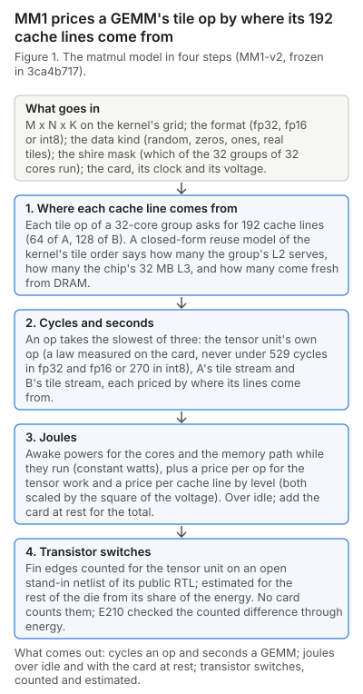
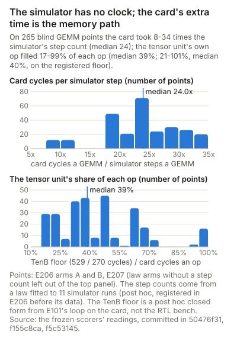
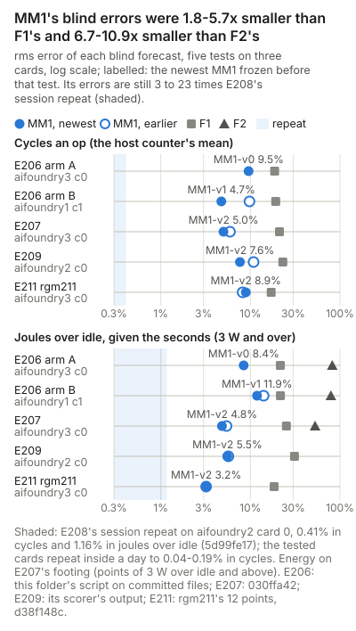
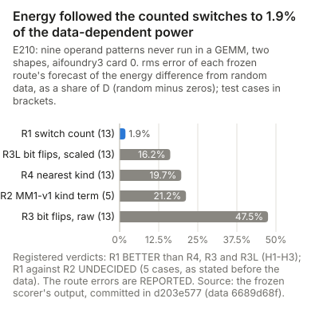
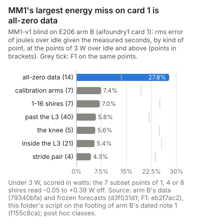

# The lab's matmul model, MM1: a GEMM's cycles, joules and transistor switches on the ET-SoC-1, and how it held up blind

*Tue 17 Nov 2026 (week 47), Pacific time. Written by the round's lane `report-final` (Q215) at the desk on aifoundry2: no card, no device
command, no simulator run. It finishes the draft of round Q209 with every finding of that round's critic applied and E209, E210 and E211
filled in. Every number is traced to its committed source and label in the section that gives it;
[`readme_numbers.py`](readme_numbers.py) finds each one in its committed file and writes [`readme-numbers.txt`](readme-numbers.txt). The figures
and every desk number are computed from committed files only by [`make_figures.py`](make_figures.py), which writes [`numbers.json`](numbers.json).
Every desk number: `/usr/bin/python3` 3.12.3, run `-I -B`, at GitHub main `8f44b380`.*

**Labels.** *Measured*: a card's committed reading. *Registered*: a forecast or a rule committed before its data existed. *Blind*: scored on
data that did not exist when the forecast was committed and pushed. *Shape-blind*: blind, and no point had run on any card before the freeze.
*Card-transfer*: blind at shapes the model was fitted on at another card, run on this card for the first time. *Held out*: left out of a fit (one
experiment or one card at a time); held out is not blind. *Post hoc*: read or fitted after the data. *Desk*: arithmetic on committed files
(this folder's scripts, or the lane named). *REPORTED*: a figure beside the registered rules that decides nothing. *NOT RUN*: a check nobody
ran. Error = forecast / measured - 1; "rms (bias)" is the quadratic mean and the mean of that error, in %.

**Words used here.** A *minion* is one of the chip's small cores; it runs two *harts* (hardware threads). A *shire* is a group of 32
minions with its own L2 cache. The *tile buffer* (TenB) is the tensor unit's operand buffer, through which the GEMM streams B. The *knee* is
the band of footprints just past the 32 MB L3 (33-70 MB), where some lines still come back from it. *J over idle* is what a GEMM adds to the
card's idle draw; *J with the card at rest* is the card's whole draw over the GEMM, its rest plus what the GEMM adds. Each energy forecast is
scored twice: *given the measured seconds* (the power model alone, on the card's own seconds) and *with the seconds forecast* (the model's
own seconds and watts). On a governed card the *governed base* is the base power the governor's higher clock adds.

**The meter.** Every joule here is the card's own board-power reading, whose absolute scale is one fixed gain for every board, never set
beside an outside meter (the lab's data READMEs, e.g. [arm B's note](../2026-11-17-e206-matmul-sweep-aifoundry1-c1/README.md.dated-note-1.md)).
The joules compare models and cards with each other, not with another lab's meter.

## On one screen

- **The question** (section 1): a model that predicts a matmul's clock cycles, energy and transistor switches from the matrix sizes and the
  operations, and a check of how well the timing simulation and the energy match the card.
- **The model** (section 2): MM1 takes M, N and K on the lab's GEMM kernel's grid, the number format, the data kind, the shire mask, the card
  and its clock, and gives cycles, seconds, joules over idle and with the card at rest, and transistor switches. It prices each tile op by
  where its 192 cache lines come from: the L2, the L3, or fresh from DRAM.
- **The timing simulation** (section 3): the lab's instruction-level simulator has no clock: on 265 blind GEMM points the card took 8 to 34
  times the simulator's step count (median 24; the counts come from a law fitted to 11 simulator runs). The RTL bench of the tensor unit is
  exact for the tensor op with its operands resident (12 micro-loop configurations, 18 registered readings within 2 cycles, one card). The
  gap is the memory path: the tensor unit's own op filled 17 to 99% of each op (median 39%).
- **Blind** (section 4): five tests on three cards, every forecast committed before the test's first card command. The newest MM1 frozen
  before each test read **4.7 to 9.5%** rms in cycles and **3.2 to 11.9%** in joules over idle (points of 3 W and above), against **17.1 to
  23.0%** and **18.4 to 31.0%** for F1, the lab's earlier GEMM route, and **52.7 to 82.0%** for F2, the energy ledger. The low end in cycles,
  4.7%, is arm B, a card-transfer test; on E207, the one test whose every point was new to every card, MM1-v2 read 5.0% and MM1-v1 5.9%, and
  MM1-v1 passed every registered rule and beat F1 and F2 on all four head-to-head rules. On aifoundry2's governed card (E209) MM1-v2 passed
  every band and beat F1 and F2; its registered win over MM1-v1 rests on the mean and is not confirmed case by case. On a second kernel (E211)
  MM1-v1 passed its absolute bands, the ratio rule could not be read (its controls failed), and MM1's cycles error rose from 3-4% on the old
  kernel to 8-9% on the new one.
- **The switch count** (section 5): E210 changed only the data and found the card's energy follows MM1's counted switches above an ungated
  base to **1.9%** of the data-dependent power, against 16 to 47% for the bit-flip prices and 20% for the nearest measured kind.
- **The card repeats itself** to about **0.4%** in cycles and **1.2%** in joules over idle, so model error, not noise, dominates.
- **What the blind tests do not show** (section 6): MM1 has no operations input: it covers one kernel (rgm136) on its grid, with no epilogue;
  every measured GEMM is warm and repeated; its energy needs a measured GEMM anchor on each card; it prices no energy for a tile kind it has not
  seen; nothing measures transistor switches (E210 tests their signal-net part through energy only).
- **Still wrong** (section 6): all-zero data on aifoundry1 card 1, narrow shire masks, the stride step at NB 8, int8 at one K block, and a
  second kernel's code path.

## 1. The question

The owner's words that started the matmul model (Mon 16 Nov 2026, at or before 09:48:24 PST; a voice transcription, where "matte mold" is the
matmul):

> "I want you to focus on the matte mold most of all, so I want to have a model which predicts matte mold energy and number of transistor
> switches and clock cycles. From based on what I know about the size of a matrix and which operations are contained. See check how well the
> timing simulation for the matte mold matches reality and the energy."

So there are three asks: **one model** (sizes and operations in; cycles, joules and transistor switches out), **a check of the timing
simulation** against the card, and **a check of the energy** against the card. The quote is as committed in
[`tools/matmul/mm1/v0/README.md`](../../../../tools/matmul/mm1/v0/README.md) (`2d1413f5`).

## 2. What MM1 takes in and gives out, and how

**The chip, in one paragraph.** The ET-SoC-1 has 1,088 minions in 34 shires (32 compute shires, a master and a spare); the lab's kernels use
1,024 of them, in 32 shires of 32 ([`docs/et-soc1-notes.md`](../../../et-soc1-notes.md); [`05-claims.md`](../../../findings/05-claims.md)).
Each minion has a tensor unit that multiplies tiles of matrices. Each shire has its own L2 cache; the chip shares a 32 MB L3; behind them is
DRAM. The lab's cards run at a fixed 600 MHz (aifoundry3 card 0 and aifoundry1 card 1 in the tests below) or under the card's own power
governor (aifoundry2's card, about 800 MHz in E208's GEMMs).

**The kernel.** MM1 covers the lab's GEMM kernel, rgm136, on its grid ([`v0/README.md`](../../../../tools/matmul/mm1/v0/README.md) section 2):
`gemmL<MB>x<NB>x<KB>` computes M = 1,024·MB, N = 512·NB, K = 512·KB·w (w = 1, 2, 4 for fp32, fp16, int8), and each minion does 64·MB·NB·KB
tile ops a GEMM. One tile op is 4,096 multiply-adds in fp32, 8,192 in fp16 and 16,384 in int8 (desk: E206's registered points,
[`points-e206.json`](../../../../tools/claims-v3/e206/points-e206.json), multiply-adds a GEMM over minions and ops). An off-grid size is padded
to the next grid point; another kernel needs its own map of its tile order (E211 tested that, section 4).

**What goes in and what comes out** (MM1-v2, frozen in `3ca4b717`, [`v2/README.md`](../../../../tools/matmul/mm1/v2/README.md)):

| in | out |
|---|---|
| M, N, K (the grid point) | cycles an op: the wall (the slowest minion) and the host counter's mean over minions |
| the format: fp32, fp16 or int8 | seconds a GEMM |
| the data kind: random, zeros, ones, and real or designed tiles where a price was fitted | watts and joules over idle: what the GEMM adds to the card's idle draw |
| the shire mask: which of the 32 shires run | joules with the card at rest: the card's whole draw over the GEMM |
| the card, its clock and its voltage | transistor switches: counted on a stand-in netlist for the tensor unit, estimated for the rest of the die |



**How, in four steps** (figure 1; the equations are in [`v1/README.md`](../../../../tools/matmul/mm1/v1/README.md) section 2 and
[`v2/README.md`](../../../../tools/matmul/mm1/v2/README.md) section 2):

1. **The memory path's line map.** A tile op of one shire asks for 192 cache lines, 64 of A and 128 of B. A closed-form model of rgm136's
   tile order (its reuse distances) and a logistic L3 retention, r(d) = 1 / (1 + exp((d - x50) / s)) with x50 = 39.7 MB and s = 4.53 MB in
   MM1-v2, say how many of them the L2 serves, how many the L3, and how many come fresh from DRAM. No constant is fitted to a shape.
2. **Cycles.** An op takes the slowest of three: the tensor unit's own op, A's tile stream and B's tile stream, each stream priced by where
   its lines come from. The tensor op's time is a law measured on the card (E119's: 527.48 cycles + 0.0176 µs in fp32 and fp16, and
   283.03 cycles + 0.0146 µs in int8), never under the floor measured with B streamed through the tile buffer, 529 and 270 cycles
   ([`v0/README.md`](../../../../tools/matmul/mm1/v0/README.md) section 2). Seconds = ops a minion × the wall time of an op.
3. **Joules.** Watts over idle = an awake power for the active minions + an awake power for the memory path + the governed base on a governed
   card + the op rate × (a price per op for the tensor work + a price per cache line by where it came from). The awake powers are constant
   watts; only the per-op and per-line prices scale with (V / 0.517 V)² ([`v2/README.md`](../../../../tools/matmul/mm1/v2/README.md)). The
   price per op is the energy ledger's frozen resident price for the format and data kind; MM1-v2's line prices are 58.9, 245.1 and 794.7 pJ
   a line (L2, L3, fresh) for zeros, plus 501.2, 1,150.2 and 1,298.6 pJ for random data. Joules = watts × seconds.
4. **Transistor switches.** The lab's unit is the fin edge: "one transistor gate, one fin, charged or discharged by a net transition"
   ([`v0/README.md`](../../../../tools/matmul/mm1/v0/README.md) section 5), so a transistor with several fins counts once per fin. MM1
   *counts* the tensor unit's fin edges on an open stand-in netlist of its public RTL (fp32 at gate level; fp16 scaled from it; int8 the vector
   unit only): an estimate for the silicon, not a count of its gates. It *estimates* every other class on the die (clock tree, memory path,
   issue, int8 arithmetic) from its share of the joules over idle, with the fresh-line energy set apart, in a low, a central and a high
   estimate ([`v1/README.md`](../../../../tools/matmul/mm1/v1/README.md) section 7). Every constant comes from the lab's public files. **No
   card counter measures switches**; section 5 tests the counted difference through energy.

**One worked example** (E207's point b25, a GEMM never run before it): 6,144 × 3,072 × 3,072, fp32, random data, all 32 shires, aifoundry3
card 0 at 600 MHz. MM1-v2's frozen forecast ([`v2/forecasts-e207.csv`](../../../../tools/matmul/mm1/v2/forecasts-e207.csv), `4e518735`,
blind) against the card ([E207's data](../2026-11-17-e207-blind-matmul-aifoundry3/README.md), `867f6a3f`, measured):

| | MM1-v2, blind | the card, measured |
|---|---|---|
| lines a shire-op: L2 / L3 / fresh | 0 / 115.98 / 76.02 | (not measured) |
| cycles an op, the counter's mean | 1,173.8 | 1,161.2 |
| milliseconds a GEMM | 27.34 | 26.78 / 26.77 (two runs) |
| millijoules over idle a GEMM | 528.7 | 519.8 (mean of 529.8 and 509.8) |
| transistor switches a GEMM | counted 4.1 to 6.2 × 10^15 (tensor unit, stand-in netlist); estimated 3.4 / 8.5 / 14.9 × 10^15 (the rest of the die, low / central / high) | not measurable |

The joules at this point are within the gap between the point's own two runs (529.8 against 509.8), so b25 shows how MM1 is used, not how
accurate its energy is; section 4 gives that.

**Three versions**, each frozen before a blind test (sections 4 and 7): **MM1-v0** (`2d1413f5`, Mon 16 Nov 2026) fitted on 769 GEMM time
points and 682 energy points from 11 earlier experiments; **MM1-v1** (`25d2e74e`) refitted with E206 arm A's data (888 time and 791 energy
points), with terms for an L2 time, power-of-two strides, shire-count contention and the memory path's awake power; **MM1-v2** (`3ca4b717`,
Tue 17 Nov 2026) refitted with E208, a matmul sweep on three cards (1,072 time and 964 energy points), with the clock as an input, per-card
terms, a price for constant-one data and contention on the DRAM stream only. Held out one experiment at a time (desk, post hoc model
selection, not blind), each version beat the one before on the same pool: cycles 4.70% for MM1-v1 against 5.91% for MM1-v0's form refitted
([v1](../../../../tools/matmul/mm1/v1/README.md) section 5.1), and 5.41% for MM1-v2 against 5.70% for MM1-v1's form refitted
([v2](../../../../tools/matmul/mm1/v2/README.md) section 0). Their own pools differ in size (769, 888 and 1,072 points), so MM1-v0's 5.54%
([v0](../../../../tools/matmul/mm1/v0/README.md) section 4) does not compare with the others.

## 3. How well the timing simulation matches the card, and how well today's energy models did



**The simulator is not a clock.** The lab's instruction-level simulator steps every active hart through its instructions with no timing. At
E206's and E207's points nobody ran it: the step counts there come from a law fitted to 11 simulator runs of rgm136 (post hoc, registered in
E206 before its data: "a post hoc desk fit on 11 sys_emu runs of rgm136 ... the simulator has no timing, its steps are instructions",
[`E206.md`](../../../../tools/claims-v3/e206/E206.md) section 7, `eb2f7ac2`), 46.625 steps an op + 24.25 a C-tile row, with + 92 a launch in
MM1's column ([`v1/README.md`](../../../../tools/matmul/mm1/v1/README.md) section 2). A step is close to, not exactly, an instruction: E211's
kit found about 5 steps for each stack load (rgm136's loop runs 36 instructions an op and 47.742 steps;
[`KIT.md`](../../../../tools/claims-v3/e211/KIT.md)). Over every blind point that has a step count, **265 points** of E206's two arms and
E207 (161 distinct configurations: arm B reran most of arm A's on another card), the card's cycles a GEMM were **8.2 to 33.9 times** the
steps, **median 24.0** (quartiles 19.4 and 29.4; desk, from the frozen scorers' registered readings in `50476f31`, `f155c8ca` and `f5c53145`).
The medians describe this test design's mix of shapes, not GEMMs in general. The low end is int8 at one K block (`gemmL1x1x1`), the high end
the long-K, DRAM-fed `gemmL1x1x32`. The step law has no term for the format or the data, while the card's cycles have both: `gemmL1x1x1` on
all 32 shires took 537.98 cycles an op in fp32 and 388.02 in int8 on aifoundry3 (E206 arm A's registered reading, measured, `50476f31`). The
simulator did see one thing the card then showed: rgm211's compiled loop takes 32.762 steps an op against rgm136's 47.742 (31 instructions
against 36), and E211's controls, where only the compiled code differs, ran 3-6% fast on the card (section 4).

**The RTL bench is exact for the tensor op with its operands resident.** A register-transfer simulation of the tensor unit, with A and B
already resident, plus one constant of 7.75 cycles set on the card in E109, gave the card's cycles an op in the three experiments that
registered it before the card ran: **18 of 18 registered readings within 2 cycles** (E129, E148 and E155, rule R6; 12 micro-loop
configurations, all with zeros data on aifoundry1 card 1; for example 544.0 forecast against 544.001 measured in fp32, 318.0 against 318.001
in int8, 62.0 against 62.0 for an op with one row of A; measured). **A GEMM is not that loop.** It streams B through the tile buffer, and its
op runs at E119's law: 527.48 cycles + 0.0176 µs is 538 cycles in fp32 at 600 MHz, and the card measured 537.98 at `gemmL1x1x1` above.
So four numbers describe the fp32 tensor op: **546** (E101's resident loop, the RTL bench's reach, which E206 registered as its floor) and 544
(the bench's m0 loop); **538** (E119's law with B streamed, at 600 MHz); and **529**, the floor MM1 never goes under, a post hoc closed form
read from E101's loop with B through the tile buffer (measured on the card, not the RTL bench; [`v0/README.md`](../../../../tools/matmul/mm1/v0/README.md)
section 6). In int8 the same roles are taken by 318, 292 and 270.

**The gap is the memory path.** Over the floor with B through the tile buffer (529 or 270 cycles), the tensor unit's own op filled **17 to
99%** of each op on the card, **median 39%**, over **285 blind points** (desk, from the same committed points). Over E206's registered floor
(546 or 318 cycles, the scorers' registered readings) it filled 21 to 101%, median 40%, over 265 points; 12 of them ran faster than that
resident floor. Near 99% sit the ops whose tiles stay in the L2; the lowest are int8 GEMMs with a long K, fed from DRAM. No simulator the lab
has models the memory path (a counted simulator run "gives instructions and bytes, never the level that served a line",
[`v0/README.md`](../../../../tools/matmul/mm1/v0/README.md) section 3); that is the part MM1's line map and stream terms fit.

**Today's energy models, before MM1** (blind, section 4's table). F1, the lab's earlier GEMM route (E190's, widened: seconds from a line-cost
law at the point's lines, watts from E136's power law), read joules over idle **18.4 to 31.0%** rms at the points of 3 W and above. Its miss
is a scale, not a shape: about a quarter low in every family on E207 ([`v2/score-e207.md`](../../../../tools/matmul/mm1/v2/score-e207.md)
section 6, `030ffa42`), and it reads a shire subset's lines from E206's masked map, which lost to MM1-v1's full-chip lines on every fold
([`v1/README.md`](../../../../tools/matmul/mm1/v1/README.md) section 4.1). F2, the lab's energy ledger (ledger v3's tensor terms with F1's
seconds), read **52.7 to 82.0%** rms, and on E207 its error grew with the lines fetched from DRAM: "+94% to +160% at the long-K points ...
against -19% to -42% at one K block"; part of that growth is its byte convention, which counts every shire's request (same section). With the
card at rest, where the idle draw dominates, the same models read 6.5 to 10.1% (F1) and 16.4 to 18.3% (F2).

## 4. The blind tests

**Blind here means:** the forecast file was committed and pushed to the lab's public repository before the test's first card command, and
the frozen scorer ran only after the data commit. A separate modelling session (its own model, refitted on the lab's committed data, arm A's
among them) also sealed forecasts before most of these days; the lab registers each by its sha256 and does not score them, and none of their
numbers is here (the list is at the end of this section).

| test | card | points (never run before the freeze) | MM1's footing and label | forecasts frozen (commit, PST) | first card command (PST) | data / scores |
|---|---|---|---|---|---|---|
| E206 arm A | aifoundry3 card 0, 600 MHz | 119 (108 never on this card, 95 never on any) | MM1-v0: blind; REPORTED (E206 registered no MM1 rule) | MM1-v0 `2d1413f5` (Mon 13:35:10); F1, F2 `eb2f7ac2` (Mon 16:01:50) | Mon 16 Nov 16:53:22 | `d7e4f35e` / `50476f31` |
| E206 arm B | aifoundry1 card 1, 600 MHz | 113 (85 never on this card) | MM1-v0: blind; MM1-v1: card-transfer (fitted on arm A's shapes at aifoundry3); REPORTED | MM1-v0 `e35a06cb` (Mon 20:13:57); MM1-v1 `d3f031d1` (21:18:46); F1, F2 `eb2f7ac2` | Tue 17 Nov 00:13:26 | `79340bfa` / `f155c8ca` |
| E207 | aifoundry3 card 0, 600 MHz | 53, 47 distinct cases (all never run on any card at both freezes) | MM1-v1: shape-blind, registered rules; MM1-v2: shape-blind, REPORTED | MM1-v1, F1, F2 `25d2e74e` (Mon 21:14:55); MM1-v2 `4e518735` (Tue 02:06:29) | Tue 17 Nov 07:06:44 | `867f6a3f` / `f5c53145`, `030ffa42` |
| E209 | aifoundry2 card 0, its governor | 45, 41 time cases (all never on this card) | MM1-v2: blind, registered rules (fitted on E208's sessions on this card) | MM1-v2, MM1-v1, F1@800, F2@800 `3ca4b717` (Tue 01:44:45) | Tue 17 Nov 10:30:44 | `ea3fa3ce` / `15870c53` |
| E211 | aifoundry3 card 0, 600 MHz | 26 (rgm211's 12 never run on any card) | MM1-v1: blind, registered rules; MM1-v2: blind, REPORTED | MM1-v1, F1, F2, NC `1393a649` (Tue 07:59:17); MM1-v2 `89aa0c94` (Tue 08:12:53) | Tue 17 Nov 13:21:20 | `38aaf004` / `8f44b380`, `d38f148c` |



**Every model on every test** (blind; rms (bias) in %; joules over idle on E207's footing, at the points of 3 W over idle and above):

| test | model | cycles an op (counter's mean) | seconds a GEMM | J over idle, given the measured seconds | J over idle, seconds forecast | J with the card at rest, given the seconds |
|---|---|---|---|---|---|---|
| E206 arm A | **MM1-v0** | **9.5 (-2.8)** | 9.0 (-2.6) | **8.4 (-5.6)** | 9.2 (-6.0) | 2.6 (-1.7) |
| | F1 | 18.7 (+10.1) | 16.0 (+6.5) | 21.6 (-17.3) | 19.4 (-12.0) | 7.8 (-6.4) |
| | F2 | - | - | 82.0 (+35.2) | 82.0 (+35.2) | 18.3 (+7.5) |
| E206 arm B | MM1-v0 | 9.8 (-2.9) | 9.2 (-2.7) | 14.1 (+6.1) | 13.9 (+5.2) | 2.4 (+0.8) |
| | **MM1-v1** | **4.7 (-1.6)** | 4.6 (-0.8) | **11.9 (+5.4)** | 12.0 (+5.2) | 2.1 (+0.7) |
| | F1 | 19.2 (+10.7) | 16.4 (+6.8) | 21.7 (-17.3) | 19.2 (-11.7) | 6.5 (-5.3) |
| | F2 | - | - | 79.2 (+37.1) | 78.6 (+36.4) | 16.4 (+7.6) |
| E207 | MM1-v1 | 5.9 (-2.4) | 5.7 (-2.6) | 5.4 (-2.1) | 5.8 (-2.4) | 2.1 (-0.7) |
| | **MM1-v2** | **5.0 (-0.9)** | 4.8 (-1.1) | **4.8 (-0.7)** | 5.2 (-0.9) | 1.9 (-0.2) |
| | F1 | 21.1 (+18.5) | 18.0 (+13.9) | 25.3 (-24.4) | 16.4 (-13.8) | 9.2 (-8.6) |
| | F2 | - | 18.0 (+13.9) | 52.7 (+25.8) | 52.7 (+25.7) | 17.5 (+8.4) |
| E209 | MM1-v1 | 10.9 (-5.6) | 8.6 (-4.3) | 5.7 (+2.5) | 7.4 (-0.6) | 2.7 (+1.0) |
| | **MM1-v2** | **7.6 (-3.7)** | 6.8 (-2.6) | **5.5 (+2.6)** | 6.9 (+1.0) | 2.8 (+1.3) |
| | F1@800 | 23.0 (+16.6) | 19.6 (+11.8) | 31.0 (-14.6) | 32.0 (-4.4) | 10.1 (-5.8) |
| | F2@800 | - | - | - | 43.7 (-22.5) | - |
| E211, rgm211's 12 points | MM1-v1 | 8.2 (+2.5) | 8.0 (+2.5) | 3.2 (-0.5) | 3.4 (-0.3) | 1.6 (-0.3) |
| | **MM1-v2** | **8.9 (+4.0)** | 8.8 (+4.0) | **3.2 (+0.6)** | 3.6 (+1.0) | 1.5 (+0.2) |
| | F1 | 17.1 (+10.1) | 14.4 (+7.8) | 18.4 (-16.2) | 11.2 (-10.7) | 8.4 (-7.1) |
| | F2 | - | - | - | 30.8 (+21.6) | - |
| | NC (the chip-lines null) | 24.7 (+18.2) | 23.4 (+16.0) | - | - | - |
| E211, the 12 rgm136 twins | MM1-v1 | 3.5 (-0.0) | 3.7 (+0.8) | 2.5 (-0.1) | 2.7 (+0.0) | 1.2 (-0.1) |
| | MM1-v2 | 2.7 (+0.3) | 2.9 (+1.2) | 2.7 (+1.1) | 2.9 (+1.3) | 1.2 (+0.4) |
| the card's repeat floor | the same schedule five hours apart (E208, aifoundry2 card 0) | 0.41 | 0.38 | 1.16 | - | - |
| | the two runs of each point in one day (E206's arms, E207) | 0.04 to 0.19 | 0.04 to 0.16 | 1.0 to 1.8 | - | - |

*Where each figure comes from.* **E206:** desk, this folder's `make_figures.py` on the footing of arm B's dated note 1, section 7
(`f155c8ca`), from committed files (data `d7e4f35e` and `79340bfa`, scorer cells `50476f31` and `f155c8ca`, forecasts `2d1413f5`,
`e35a06cb`, `d3f031d1` and `eb2f7ac2`); time at every point (119 and 113); joules over idle at the points whose measured W over idle is 3 W
or more (101 for MM1-v0 on arm A, 98 for both MM1 versions on arm B). On every point, the footing of arm B's note, arm B's MM1-v1 reads 14.3%
(n 105) and arm A's MM1-v0 9.8% (n 109); at the points under 3 W, in watts, MM1-v1 reads 0.21 W rms on arm B's 7 and MM1-v0 0.31 W on arm A's
8. **E207:** MM1-v2's committed score (`030ffa42`): time per case over the 47 cases, joules over idle at the points of 3 W and above (46 for
MM1-v2, 50 for MM1-v1, 47 for F1, 46 for F2); F2 takes F1's seconds, so its seconds cell repeats F1's. **E209:** desk, this folder's script on
the frozen scorer's per-case and per-point figures (`15870c53`), the models at each run's measured clock (route m); time per case over the
41 cases, energy per point (45 for MM1-v2, 39 for MM1-v1, 42 for F1@800 and F2@800; no E209 point read under 3 W). F2@800 under-forecasts
there, and a relative error cannot go below -100%: on the scorer's own footing, the rms of ln, it reads 82.2%. **E211:** MM1-v2's committed
score (`d38f148c`), every point above 3 W; F2 has no frozen function of the seconds, so its given-seconds cells are empty.

**How blind each test is, and what the newest MM1 read on the new points alone** (desk):

- **E206 arm A.** 24 of its 119 points are bridges from experiments in MM1-v0's own fit (11 of them on aifoundry3 itself). On the 95 points
  never run on any card MM1-v0 read **10.2% (-2.9)** in cycles and **10.4%** in joules over idle (8.8% at 3 W and above); on the 24 bridges,
  6.2% and 7.1%.
- **E206 arm B** is, for MM1-v1, a card-transfer test: its shapes are arm A's, which MM1-v1 was fitted on at aifoundry3, run on card 1 for
  the first time (card 1 itself was in its fit through earlier experiments: MM1-v0 already carried an awake power of 3.660 W for it,
  [`v0/README.md`](../../../../tools/matmul/mm1/v0/README.md) section 2). On the 85 points never run on card 1, MM1-v1 read 4.7% in cycles
  and 15.5% in joules over idle (n 77), as its note gives them (`f155c8ca`). MM1-v0 had seen none of either arm.
- **E207** is the shape-blind test: its 53 points never ran on any card before MM1-v1 and MM1-v2 were frozen. One configuration, b50's, then
  ran on aifoundry1 in the separate session's sweep at 05:30 and 06:16 PST, before E207's card day and after both freezes
  ([`v2/score-e207.md`](../../../../tools/matmul/mm1/v2/score-e207.md) section 1).
- **E209** tests MM1-v2 on a card it was fitted on (E208's two sessions there), at 45 points never run on that card, under its governor.
- **E211**'s rgm211 is a kernel no card had run, forecast through a desk map of its tile order; its 12 rgm136 twins are the old kernel at the
  same shapes (4 of them in both models' fit, 3 run in E207 before the freeze, 5 never run).

### E207: the shape-blind day (registered)

Every rule on MM1-v1 **PASS** (its frozen scorer, `f5c53145`). A rule passes when at least 90% of its cases or points sit within twice
MM1-v1's larger held-out error: 13 to 16% per case in cycles and seconds, 15 to 16% per point in joules over idle, 5% and 13% with the card at
rest ([`E207.md`](../../../../tools/claims-v3/e207/E207.md) section 7). T1 45/47, T2 44/47, T3 45/47; E1 50/53, E2 48/53, E3 51/53, E4 50/53.
**MM1-v1 BETTER on all four head-to-head rules**: H1 against F1 on the wall cycles 39 to 8 (exact sign test p 5.5e-06, which treats the cases
as independent), H2 on the counter's mean 45 to 2, H3 and H4 against F2 on joules over idle 47 to 2 each; the family-level check that E207's
amendment asks to be read beside each verdict agrees (7/0/0 against F1, 8/0/0 against F2). **MM1-v2 against MM1-v1** (`030ffa42`; REPORTED):
NOT DECIDED in time and in joules over idle (wall cycles closer at 24 cases against 18, p 0.44). On joules at rest with the seconds forecast
the sign test favours MM1-v2 (30 against 11, p 0.0043), but the family-level check does not confirm it (TOO FEW; NOT DECIDED).

### E209: aifoundry2's governed card (registered)

**The day** (data `ea3fa3ce` and its notes): 62 of 62 runs in 26.16 card-minutes, first card command 10:30:44 PST, 8 h 46 min after MM1-v2's
forecasts were pushed (`3ca4b717`); 29 shapes, three formats, four data kinds, five shire counts, none run on this card before. The card's
governor chose the clock, read and never set: 15,675 of 15,675 samples carry it (600 MHz 11,545, 700 MHz 131, 800 MHz 3,999), it stepped
inside every device process, and each run is scored at its view's measured clock. **The rules** pass when at least 90% of cases or points
sit within twice MM1-v2's larger held-out error: 19% in cycles and seconds, 14% and 15% in joules over idle, 5% and 13% with the card at rest
([`E209.md`](../../../../tools/claims-v3/e209/E209.md) section 7). **The registered verdicts** (the frozen scorer's printed lines, `score.out`,
committed beside the data in `15870c53`; dated note 15, `b067742b`): R0 PASS; T1m, T1c, T2m, T2c, T3m and T3c PASS at 39 of 41; E1 PASS 45/45, E2m 42/45, E2c 41/44, E3 43/45, E4m 42/45,
E4c 41/44; K1 (the clock forecast) PASS 44/45; H1-H3 MM1-v2 BETTER, H4 NOT DECIDED, H5 and H6 MM1-v2 BETTER.

- **MM1-v2's errors** (the scorer's own summaries, rms of ln): wall cycles **7.2%**, MM1-v1 9.3%, F1@800 18.1%; joules over idle given the
  seconds **5.4%** (45 points), MM1-v1 5.6% (39); F2@800 with its seconds 82.2%.
- **The head-to-head with MM1-v1 is weak** (REPORTED beside each verdict, note 15). H1-H3's "MM1-v2 BETTER" rests on the bootstrap interval of
  the mean difference (+0.0158, 95% [+0.0037, +0.0293] in ln); the sign test reads 17 against 11 (p 0.345: NOT DECIDED), the bootstrap of the
  median spans 0, and the families split 2 against 2. The subsets carry 67% of the summed difference. So it reads as **MM1-v2 closer on
  average, mostly through the subsets, not closer case by case**. Against F1@800 (H5, 38 against 3, p 1.05e-08) and F2@800 (H6, 35 against
  5, p 1.38e-06) every side reading agrees.
- **Its largest misses** (post hoc margins, note 15): `gemmL2x6x10` fp32 on the one shire 0x80000000 (e39) ran 24% more cycles than MM1-v2
  forecast, `gemmL3x1x5` fp32 (e15) 19%; `gemmL6x6x6` int8 on four shires (e42) failed T2's 19% band by 0.03 points. The stride step at NB 8
  measured 1.297 against MM1-v2's 1.187; int8 at one K block (e07) ran 1.158 times MM1-v2's wall cycles; real int8 tiles saved 9.0% of the
  joules against MM1-v2's 2.7%.

### E211: a second kernel (registered)

**The day** (data `38aaf004`): 38 of 38 runs and the smoke in 17.99 card-minutes on aifoundry3 card 0. rgm211 is rgm136 with its C-block walk
swapped; MM1-v1 forecast it through a desk map of the new tile order, beside F1 and NC, a null that prices the chip's lines alone. **The bands**
are E207's (13%, 16% and 13% in cycles and seconds; 15%, 16%, 5% and 13% in joules), PASS at 90% of rgm211's 12 points
([`E211.md`](../../../../tools/claims-v3/e211/E211.md) section 7). **The registered verdicts** (the frozen scorer's printed lines, `scores-e211-A.txt`, committed beside the data in `8f44b380`): R0 and S6 PASS; **T1 11/12, T2
12/12, T3 11/12, E1 12/12, E2 12/12, E3 11/12, E4 12/12: PASS**; **T4 FAIL**: the controls, where both walks are one op stream and every model
says 1, ran 2.9% and 5.8% fewer wall cycles on rgm211 (tolerance 0.01 in ln): there the only difference is the recompiled kernel's
instruction stream (section 3); amendment A1 did not apply (the two controls differ by 0.031 in ln), so W1, the ratio rule, reads FAIL 5/10 and "not a
model test"; W2 (the direction) PASS; H5, MM1 against NC on the wall, MM1 BETTER (10/1/1, p 0.0117); H1-H4 and H6 NOT DECIDED.

- **MM1-v2 blind** (frozen 5 h 8 min before the first card command; `d38f148c`, REPORTED): on rgm211's 12 points its wall cycles read
  **8.9%** rms (+4.0), MM1-v1 8.1%, F1 14.5%, NC 23.5%; on the 12 rgm136 twins MM1-v2 read 2.9% and MM1-v1 3.7%. Joules over idle given the
  seconds stayed at about **3%** on rgm211 (3.2% for both versions; F1 18.4%). The ratio rgm211 / rgm136 over 10 pairs, rms of ln: MM1-v2
  0.074, MM1-v1 0.065, F1 0.128, NC 0.126, N0 (no walk effect) 0.135; MM1-v2 against MM1-v1 decided no time quantity.
- **Reading:** on a kernel it never saw, MM1 kept joules to about 3%, but its cycles error rose from 3-4% to 8-9%, and the walk's own effect
  cannot be separated from the code difference the controls show.

### E206: the two arms (REPORTED: E206 registered no MM1 rule)

- **Arm A:** MM1-v0 closer than F1 at **89 of 119** points in cycles and **96 of 109** in joules over idle; closer than F2 at **104 of 109**
  (desk).
- **Arm B:** MM1-v1 closer than F1 at **87 of 113** in cycles and **85 of 105** in joules over idle; closer than F2 at **99 of 105**
  (`f155c8ca`). MM1-v1 was closer than MM1-v0 at 69 of 113 in cycles.

### The card's repeat floor

The same 85-run schedule, run twice five hours apart on aifoundry2 card 0 (E208's session repeat, `5d99fe17`; measured, post hoc table),
repeated to **0.41%** rms in cycles an op (the counter's mean; 0.38% on the slowest minion), 0.38% in seconds, **1.19%** in watts over idle
and **1.16%** in joules over idle (0.72% with the die corrected to 50 C, post hoc). Inside one day the two runs of each point at 600 MHz
differed by 0.04 to 0.19% rms in cycles and 1.0 to 1.8% in joules over idle at the points of 3 W and above (desk, this folder's script, from
the data of E206's two arms and E207). MM1's blind errors are 3 to 23 times the session repeat: **the model's error, not the card's noise,
sets the score.**

### The separate session's sweeps and sealed forecasts

- **E208** (the separate session's matmul sweep: rgm136 unchanged, 74 arms on three cards; registered `d005dc53`) is complete: six sessions
  and a seventh that repeated the first, all committed (`e99209a5`, `eed9624f`, `d40b6fe8`, `76fb5344`, `7693a23c`, `c2d6536c`; `5d99fe17`).
  MM1-v2 was fitted on it, so it is not a blind test of MM1-v2.
- **E212** (its second sweep: 221 arms and an anchor in 10 sessions; registered `c83a29d1`) is in progress: seven of ten sessions are
  committed (`d2ece7e8`, `5601b6a7`, `7726e127`, `a90105da`, `7dfba40b`, `ebe552fe`, `d8de38b0`).
- **Its sealed forecasts**, each registered by sha256 before the data it covers (the contents stay sealed; theirs to score, and the lab
  scores none):

| test | sha256 (first 8) | registered in |
|---|---|---|
| E206 arm B | `bc750c73`, `9db8898a` | `cb25db36`, `c931b3d8` |
| E207 | `26a17d64` | `221a233f` |
| E208 | `087fa8fd` | `d005dc53` |
| E209 | `2adc7fd3` (posted after E209's session, before its data commit: REPORTED) | `d6d62660` |
| E210 | `81a84eb6` | `75ecdd29` |
| E211 | `7e5a361e` | `51d74428` |
| E212 | `4d77f137`; `8f2df483` (six sessions) | `c83a29d1`; named in `7dfba40b` |

## 5. The switch count, through energy (E210)



**The question:** MM1 reports switches; nothing on a card counts them. At one GEMM shape the kernel runs the same instructions on the same
lines in the same cycles whatever the data, so the energy difference between an operand pattern and random data is data switching. E210 ran
nine fp32 operand patterns never run in a GEMM, at two shapes (`gemmL1x1x1` in the L2 and `gemmL1x1x4` inside the L3) on aifoundry3 card 0,
each in chained blocks against random, and asked whether the difference follows MM1's counted switches better than four other routes
([`E210.md`](../../../../tools/claims-v3/e210/E210.md), `7b59f719`; data `6689d68f`; scores `d203e577`). **The switch route (R1)** is MM1-v1's
counted switches times one constant per shape, calibrated on committed ungated kinds (ones and real tiles: every lane valid, so the clock
part of the count is random's and cancels), plus MM1-v1's line term. **The registered result:** R0 PASS; the time equality PASS in all 20 cases; B5 (R1 within 5% of D, the
data-dependent power, random minus zeros: 29.78 W and 20.53 W) PASS 13 of 13; **R1 BETTER** than the nearest measured kind (H1, 10 to 1),
the raw bit-flip price (H2, 12 to 0) and the bit-flip price with one scale (H3, 10 to 0); R1 against MM1-v1's kind term UNDECIDED (4 to 0
with 1 tie; 5 cases, too few to decide, as registered). **REPORTED:** R1's error is **0.481 W rms, 1.87% of D**, against 3.849 W (16.19%)
for the scaled bit flips, 5.128 W (19.71%) for the nearest kind, 5.575 W (21.22%, 5 cases) for MM1-v1's kind term and 12.165 W (47.48%)
for the raw bit flips; the card's own constant, fitted post hoc, sits within 0.8% of the calibrated one (S1 1.6767 × 10^16 switches a J
against 1.6733 × 10^16; S2 1.6235 against 1.6367 × 10^16). With the pattern as the unit (REPORTED), H1 is UNDECIDED (6 to 1, 1 tie).

- **The run was cut, as registered:** 142 of 171 runs, when the card-time rule stopped new runs at 85.01 card-minutes (the die gate made each
  run about 35 s, not the planned 26); the registered subset (the opening and passes 1-4) is complete, and 9 of the 13 test cases are scored
  on 2 of 3 blocks.
- **What it tests, and what it does not:** the signal-net part of the count, not its clock part (the clock part cancels in every scored
  difference); fp32, one card, two shapes; ungated patterns only. Switches themselves are never measured.
- **The known miss it was built around:** MM1's fin-edge count misprices register clocking: committed data put ones at about 0.31 of D where
  the count says about 0.05 (E210.md section 1). That is why R1 is calibrated on ungated kinds, and why its success says nothing yet about the
  clock nets or about gated data (zeros, sparse tiles).

## 6. What is still wrong, and the limits of the claim



**The scope limits** (each stated in the registrations before the data):

- **No operations input.** MM1 models one kernel, rgm136, on its grid (M a multiple of 1,024, N of 512, K of a block), with no epilogue: no
  bias, activation or requantization. "From the sizes and operations" holds for that kernel's tile order only; E211 shows a recompiled
  kernel's cycles drift 8-9% even with its tile order mapped.
- **Warm, repeated GEMMs.** Every measured GEMM repeats the same A and B, so an L3-sized footprint is served from the L3 after the first pass;
  sizes below the grid come only from shire subsets.
- **A GEMM anchor on every card.** The awake power does not carry across cards: held out a card at a time, MM1-v2's energy reads 10.13%
  against 9.15% for MM1-v1's form ([`v2/README.md`](../../../../tools/matmul/mm1/v2/README.md) section 0), and MM1-v1's 14.2-42.1%
  ([`v1/README.md`](../../../../tools/matmul/mm1/v1/README.md) section 5).
- **No energy for an unseen tile kind.** MM1 prices random, zeros, ones and the real tiles it was fitted on, and nothing else: E207's real
  and designed tiles b49-b52 were NOT FORECAST in energy, and on E209 MM1-v2's desk transfer of real tiles from another card missed the int8
  saving by 6 points.
- **Switches are estimates.** Counted on a stand-in netlist for the tensor unit, estimated for the rest; E210 checked the counted signal-net
  difference through energy on one card in fp32.

**The misses the blind days named** (post hoc readings of blind data):

- **All-zero data on card 1.** On arm B's 14 all-zero points MM1-v1 read joules over idle **27.8%** rms (**+25.7%** bias) and MM1-v0 33.7%
  (+31.4%), where F1 read 13.5% and was closer at 13 of the 14 (`f155c8ca`). MM1-v1's card-1 awake power came from one shape; on E208's
  card-1 zeros it read watts over idle +21.2% (42 runs, unread, [`v2/README.md`](../../../../tools/matmul/mm1/v2/README.md) section 1).
  MM1-v2 refitted card 1's awake power on E208 (2.406 W at 1,024 minions against MM1-v1's 3.257 W); no blind test of MM1-v2 on card 1 has run.
- **Narrow shire masks.** On arm B the subset points of 3 W and above read 7.0% for MM1-v1; the 7 under 3 W (1, 4 or 8 shires, 0.31 to
  2.78 W over idle) read -0.05 to +0.39 W off, MM1-v1 high at 6 of them, and its four one-shire points sit +0.18 to +0.22 W high, which a
  relative error shows as +62% and +43% at the two smallest (`f155c8ca`). On E207, MM1-v1's two 1x2x2 subset cases
  read -14.0% (mask 0x3) and -10.2% (0xfff) in wall cycles; MM1-v2's contention on the DRAM stream alone moved them to -0.5% and -0.9%, and
  its worst E207 case was 3x6x4 fp32 on 12 shires (0xfff), +13.3%: on that mask the shape ran faster than on 2 or on 24 shires, which no
  model forecast ([`v2/score-e207.md`](../../../../tools/matmul/mm1/v2/score-e207.md) section 6, `030ffa42`). On E209 the one shire 0x80000000
  ran 24% over MM1-v2 (above), while MM1-v2 was closer than MM1-v1 at 6 of the 9 subset points.
- **The stride step and one K block.** E209's step at NB 8 measured 1.297 against MM1-v2's 1.187; int8 at one K block ran 1.158 times
  MM1-v2's wall cycles on E209 (e07) and -14.0% on E207 (n01); joules over idle at one K block read -18.4% (E207's n02, int8) and -13.6% (n03,
  fp32); int8 inside the L3 ran 6.3 to 6.6% more cycles than fp32 at the same shapes on E207, which both MM1 versions forecast equal.
- **The second kernel's code path** (E211, above): rgm211's controls ran 3-6% fast, and MM1's cycles error there was 8-9%.
- **The governor's clock**: K1's one miss (e44, 788.9 MHz measured against 764.1 forecast) and two of 55 runs whose capped state MM1-v2
  read wrong (note 15).

The lab's residual analysis of every blind and unread miss (`a514caf0`, post hoc) names candidate terms for each of these.

## 7. How to reproduce

**The commits** (all on the lab's GitHub main):

| what | commit | folder |
|---|---|---|
| MM1-v0 as frozen; its arm B forecasts | `2d1413f5`; `e35a06cb` | [`tools/matmul/mm1/v0/`](../../../../tools/matmul/mm1/v0/) |
| MM1-v1 as frozen, with F1 and F2 for E207; its arm B forecasts | `25d2e74e`; `d3f031d1` | [`tools/matmul/mm1/v1/`](../../../../tools/matmul/mm1/v1/) |
| MM1-v2 as frozen, with E209's forecasts; its E207 and E211 columns; its E207 and E211 scores | `3ca4b717`; `4e518735`, `89aa0c94`; `030ffa42`, `d38f148c` | [`tools/matmul/mm1/v2/`](../../../../tools/matmul/mm1/v2/) |
| E206: registration with F1 and F2; arm A data and scores; arm B data and scores | `eb2f7ac2`; `d7e4f35e`, `50476f31`; `79340bfa`, `f155c8ca` | [`tools/claims-v3/e206/`](../../../../tools/claims-v3/e206/), [arm A](../2026-11-16-e206-matmul-sweep-aifoundry3/), [arm B](../2026-11-17-e206-matmul-sweep-aifoundry1-c1/) |
| E207: registration, kit, data, scores | `3649245b`, `117885d9`, `867f6a3f`, `f5c53145` | [`tools/claims-v3/e207/`](../../../../tools/claims-v3/e207/), [data](../2026-11-17-e207-blind-matmul-aifoundry3/) |
| E209: registration and kit; data; note 15 and its erratum; scores | `d7b574f5`, `157d1b83`; `ea3fa3ce`; `b067742b`, `d4bd2425`; `15870c53` | [`tools/claims-v3/e209/`](../../../../tools/claims-v3/e209/), [data](../2026-11-17-e209-blind-matmul-aifoundry2/) |
| E210: registration, kit, data, scores | `7b59f719`, `8f420314`, `6689d68f`, `d203e577` | [`tools/claims-v3/e210/`](../../../../tools/claims-v3/e210/), [data](../2026-11-17-e210-switch-test-aifoundry3/) |
| E211: registration, kit, data, scores | `1393a649`, `2b7f261f`, `38aaf004`, `8f44b380` | [`tools/claims-v3/e211/`](../../../../tools/claims-v3/e211/), [data](../2026-11-17-e211-second-kernel-aifoundry3/) |
| E208's session repeat | `5d99fe17` | [data](../2026-11-17-e208-mmsweep-a2c0-S1r/) |
| the RTL bench's registered readings (rule R6) | E129, E148, E155 | [E129](../2026-11-02-e129-int8-noissue/), [E148](../2026-11-02-e148-int8-excess/), [E155](../2026-11-03-e155-int8-floor-rows/) |

**The commands** (from the repository's top, `/usr/bin/python3` with numpy for the models, the standard library for the rest; each writes
into a new folder):

```
/usr/bin/python3 -I -B tools/matmul/mm1/v0/mm1_v0.py --out <dir>          # MM1-v0: its four frozen outputs, byte for byte (v0 README, section 9)
# MM1-v1 and MM1-v2: the order in their READMEs (v1 section 10; v2 section 9, about 16 minutes in all)
/usr/bin/python3 -I -B tools/claims-v3/e206/score_e206.py docs/reports/data/2026-11-16-e206-matmul-sweep-aifoundry3/data-e206.json --out <file>
/usr/bin/python3 -I -B tools/claims-v3/e206/score_e206.py docs/reports/data/2026-11-17-e206-matmul-sweep-aifoundry1-c1/data-e206.json --out <file>
/usr/bin/python3 -I -B tools/claims-v3/e207/score_e207.py docs/reports/data/2026-11-17-e207-blind-matmul-aifoundry3/data-e207.json --out <file>
/usr/bin/python3 -I -B tools/claims-v3/e208/proposal/src/reduce_mms.py docs/reports/data/2026-11-17-e209-blind-matmul-aifoundry2/session --out <dir>/data-e209.json --txt <dir>/reduce-e209.txt
OMP_NUM_THREADS=1 /usr/bin/python3 -I -B tools/claims-v3/e209/score_e209.py <dir>/data-e209.json --out <dir>/scored-e209.json    # no point labelled "ran before"
/usr/bin/python3 -I -B tools/claims-v3/e210/score_e210.py docs/reports/data/2026-11-17-e210-switch-test-aifoundry3/data-e210.json --out <file> --txt <file>
/usr/bin/python3 -I -B tools/claims-v3/e211/score_e211.py docs/reports/data/2026-11-17-e211-second-kernel-aifoundry3/data-e211.json --out <file>
/usr/bin/python3 -I -B tools/matmul/mm1/v2/score_v2_e211.py --config tools/matmul/mm1/v2/score-e211-config.json --out <file>    # MM1-v2 on E211
/usr/bin/python3 -I -B docs/reports/data/2026-11-17-matmul-model/make_figures.py --repo . --out <dir>    # numbers.json and the five figures
/usr/bin/python3 -I -B docs/reports/data/2026-11-17-matmul-model/readme_numbers.py --repo . --numbers <dir>/numbers.json
/usr/bin/python3 -I -B docs/reports/data/2026-11-17-matmul-model/build_page.py --repo . --out <file>    # the page, from this README and the figures
```

`make_figures.py` checks every input's sha256 first and stops (exit 4) if one changed; `readme_numbers.py` finds every number of this README
in its committed file and prints one line a number with its file and the commit that last touched it.

## Files in this folder

| file | what |
|---|---|
| `README.md` | this report |
| `fig-1-model.svg` ... `fig-5-misses.svg` | the figures, drawn by `make_figures.py` |
| `make_figures.py` | the figures and `numbers.json`, from committed files only |
| `numbers.json` | every number the figures draw and every desk number here, with the inputs' sha256 |
| `readme_numbers.py`, `readme-numbers.txt` | the check list: every number of this README against its committed file |
| `build_page.py` | the page `docs/reports/2026-11-17-matmul-model/index.html`, built from this README and the figures |

SPDX-License-Identifier: Apache-2.0
