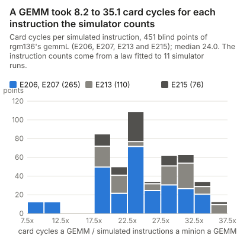
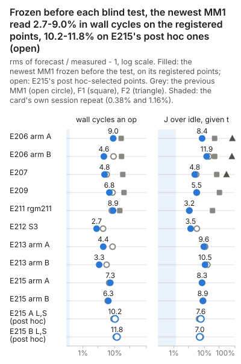
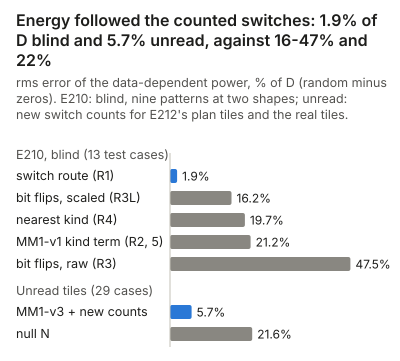
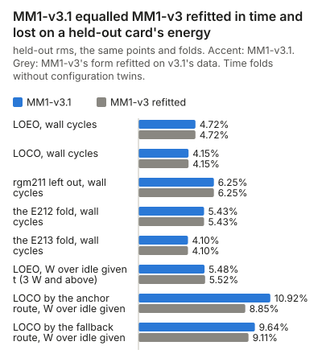
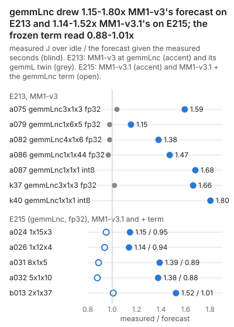

# The lab's matmul model, MM1, second version: a GEMM's cycles, joules and transistor switches on the ET-SoC-1, and how it held up blind

## On one screen

**In short.** The lab's matmul model, MM1, predicts how many clock cycles and joules a matrix multiplication (a GEMM) takes on an ET-SoC-1
card, and how many transistors switch, from the matrix sizes, the number format, the data, the card and, since its fourth version, the
operations the kernel's loop contains. Since the first version of this report, MM1-v3 was frozen and tested blind on two cards (E213): it kept
the wall cycles to 4.1% rms and beat its predecessor on all five registered head-to-head rules, but it under-priced one loop's energy by up to
1.8 times. Its declared refit, MM1-v3.1, came out no better held out, and on its own blind day (E215) it failed its registered time bands on both
cards (27 of 32 and 15 of 18 cases within 10%, against 90% needed) and its four energy rules on aifoundry3: three by that loop's four points
alone, the fourth (the card's whole joules with the seconds forecast) by two of them and by two points just past the L3's first retention
edge. *E206 to
E215 are the lab's numbered experiments (E208, E212 and E214 are a separate modelling session's sweeps); MM1-v0 to MM1-v3.1 are successive
versions of the model, each frozen before a test; F1 is the lab's earlier GEMM route and F2 its energy ledger. The labels (blind, unread,
REPORTED and the rest) are defined under "About this report", below the summary.*

- **The timing simulation** (section 3): it counts a kernel's instructions and memory requests exactly (its traces matched MM1-v3.1's
  masked walk at 352 of 352 working minions at each of two masks), but it has no clock and no caches: over 451 blind points the card took 8.2 to 35.1 cycles for each simulated instruction.
- **The scorecard** (section 4): frozen before each blind test, the newest MM1 read **2.7 to 9.0%** rms in wall cycles on each test's
  registered points and **3.2 to 11.9%** in joules over idle given the measured seconds, against **14.5 to 19.7%** and **18.4 to 31.0%** for F1
  on the first version's five tests. On E215's post hoc-selected points (families L and S), MM1-v3.1 read 10.2 and 11.8% in wall cycles on
  arms A and B; the low end, 2.7%, is E212's S3, where 29 of its 46 cases repeat a configuration MM1-v3 was fitted on (4.21% on its 17 new ones).
- **E213** (section 4.3), MM1-v3's blind day on two cards: every time rule and all but one energy rule passed, and MM1-v3 beat MM1-v2 on all
  five pooled head-to-head rules (wall cycles closer at 86 cases, farther at 13).
- **E215** (section 4.5), MM1-v3.1's blind day: both arms ran full (aifoundry3 card 0, 119 of 119 runs; aifoundry1 card 1, 71 of 71 runs
  after a second booking); pooled against MM1-v3, MM1-v3.1 was NOT DECIDED in time, as registered, and on the post hoc layouts MM1-v3 was
  better.
- **The two candidate terms, on E215** (sections 4.5 and 6.5; REPORTED): the gemmLnc term cut that loop's energy miss from 24.53% to 9.18%
  rms at its five points but overshot on arm A; the layout term moved almost no case. Of the forms added to MM1-v3.1, a shire-count-only
  control came closest, but MM1-v3 itself, with no layout term, was closer than every frozen layout form, and MM1-v2 closer still.
- **The switch count, through energy** (section 5): blind on E210, energy followed MM1's counted switches to **1.9%** of the data-dependent
  power (one fitted constant per shape; REPORTED); unread, on data patterns MM1-v3 could not price before, its switch route with 179 new bench
  counts read **6.8%** against **25.0%** for a null (closer at 35 cases, farther at 5), and on E214's 20 new kinds 7.76% against 28.05%; blind
  on E215's 12 newly counted kinds (post hoc-selected), MM1-v3.1's J over idle given the seconds read 8.45%, but +23.6% at int8 data of plus
  and minus one.
- **E214** (section 4.4), the separate session's third sweep (622 runs on aifoundry1's two cards, committed and verified), scored unread:
  MM1-v3.1 read 6.66% in wall cycles and MM1-v2 8.06%, and MM1-v3.1's declared time bands failed on both cards.
- **MM1-v3.1** (section 6), declared before E213's data and fitted after it, kept MM1-v3's time form by its own rules (4.72% against 4.72% in
  wall cycles held out) and failed two of its acceptance rules: it is frozen as built.
- **The card repeats itself** to about **0.4%** in cycles and **1.2%** in joules over idle, so model error, not noise, dominates.
- **Still wrong** (section 7): the non-cooperative loop's energy (1.15 to 1.80 times the forecast at all seven E213 points; on E215 the frozen
  term overshot), the time of sparse shire subsets (10 of E215's layouts ran 10.1% to 16.6% faster than MM1-v3.1 forecast), the time just
  past the L3's first retention edge (gemmL2x1x7 ran 12.7% to 14.9% slower than MM1-v3.1 forecast on both cards: 4 of the 8 cases past E215's
  registered T1 band) and at one K block (11.0% and 10.9% slower), and a held-out card's energy scale.

## About this report

*Thu 19 Nov 2026 (week 47), Pacific time. Written by the round's lanes `report-v2-draft` and `report-v2-final` (Q226) at the desk on
aifoundry2, and corrected by `report-v2-fix` after an independent verification (the changelog at the end): no card, no device command, no
simulator run; every figure here is quoted from a committed file or is desk arithmetic on committed files. It is the second version of the
report first committed in `600a8fb9` (Tue 17 Nov 2026; [the first version](../2026-11-17-matmul-model/README.md)) and adds the matmul work
committed since, up to GitHub main `7edf3477` (E215's pooled scores, committed at 15:51:20 PST); the corrections also cite `c9adc716`, the
frozen terms' own REPORTED score on E215 (committed at 16:14:47 PST). E216, registered that afternoon, and E217, the separate session's
fourth sweep, are left to a later version. Every number is traced to its committed source:
[`numbers.json`](numbers.json) gives each one's value, the token printed here, the phrase that holds it, its label and its source (a commit
and a file, with a key path, a literal or a named desk function), and [`check_numbers.py`](check_numbers.py) re-reads every one from that
source with its own code and fails on any mismatch. The figures and every desk number come from committed files only, by
[`make_figures.py`](make_figures.py). Every desk number: `/usr/bin/python3` 3.12.3, run `-I -B`.*

**Labels.** *Measured*: a card's committed reading. *Registered*: a forecast or a rule committed before its data existed. *Blind*: scored on
data that did not exist when the forecast was committed and pushed. *Shape-blind*: blind, and no point had run on any card before the freeze.
*Card-transfer*: blind at shapes the model was fitted on at another card, run on this card for the first time. *Unread*: scored on data that
existed before the forecast but that the model never read. *Held out*: left out of a fit (one experiment, card, kernel or mask layout at a
time); held out is not blind. *Post hoc*: read or fitted after the data. *Post hoc-selected*: points chosen after a fit by a reading
its declaration did not name, their forecasts frozen before the data (E215's families L and S): blind, but reported apart. *Desk*: arithmetic on committed files. *REPORTED*: a figure beside the
registered rules that decides nothing. *NOT RUN*: a check nobody ran.
**Error = forecast / measured - 1** in every table of this report, the first version's convention; E213's and E215's frozen scorers score
measured / forecast - 1, and where this report quotes their own figures it says so. "rms (bias)" is the quadratic mean and the mean of that
error, in %.

**Words used here.** A *minion* is one of the chip's small cores; it runs two *harts* (hardware threads). A *shire* is a group of 32 minions with
its own L2 cache. *J over idle* is what a GEMM adds to the card's idle draw; *J with the card at rest* is the card's whole draw over the GEMM.
Each energy forecast is scored *given the measured seconds* (the power model alone) or *with the seconds forecast* (the model's own seconds and
watts). The lab's GEMM kernel is *rgm136*; its default loop *gemmL* issues its operand loads in cooperation groups, and *gemmLnc* is its
non-cooperative branch; *rgm211* is rgm136 with its C-block walk swapped and recompiled (E211). A *configuration twin* is a scored point whose
card, kernel, arm, format, shire mask and clock are also in the training set that priced it. *LOEO*, *LOCO* and *LOLO* leave one experiment, one
card or one mask layout out of a fit.

**The meter.** Every joule here is the card's own board-power reading, whose absolute scale is one fixed gain for every board, never set
beside an outside meter. The joules compare models and cards with each other, not with another lab's meter.

## 1. The question

The owner's words that started the matmul model (Mon 16 Nov 2026, at or before 09:48:24 PST; a voice transcription, where "matte mold" is the
matmul):

> "I want you to focus on the matte mold most of all, so I want to have a model which predicts matte mold energy and number of transistor
> switches and clock cycles. From based on what I know about the size of a matrix and which operations are contained. See check how well the
> timing simulation for the matte mold matches reality and the energy."

So there are three asks: **one model** (sizes and operations in; cycles, joules and transistor switches out), **a check of the timing
simulation** against the card, and **a check of the energy** against the card. The quote is as committed in
[`tools/matmul/mm1/v0/README.md`](../../../../tools/matmul/mm1/v0/README.md) (`2d1413f5`).

## 2. What MM1 takes in and gives out, and how

**The chip, in one paragraph.** The ET-SoC-1 has 1,088 minions in 34 shires (32 compute shires, a master and a spare); the lab's kernels use
1,024 of them, in 32 shires of 32 ([`docs/et-soc1-notes.md`](../../../et-soc1-notes.md); [`05-claims.md`](../../../findings/05-claims.md)).
Each minion has a tensor unit that multiplies tiles of matrices. Each shire has its own L2 cache; the chip shares a 32 MB L3; behind them is
DRAM. The lab's cards run at a fixed 600 MHz (aifoundry3 card 0 and aifoundry1 card 1) or under the card's own power governor (aifoundry2's card
and aifoundry1 card 0).

**The kernel and its operations.** MM1 covers the lab's GEMM kernel rgm136 on its grid: `gemmL<MB>x<NB>x<KB>` computes M = 1,024·MB,
N = 512·NB, K = 512·KB·w (w = 1, 2, 4 for fp32, fp16, int8) ([`v0/README.md`](../../../../tools/matmul/mm1/v0/README.md) section 2). Since
MM1-v3 it also takes **the operations the kernel's loop contains**, as a counted census of each loop's instructions: rgm136's cooperative gemmL
and its non-cooperative gemmLnc, and rgm211's gemmLn and gemmL ([`v3/README.md`](../../../../tools/matmul/mm1/v3/README.md) section 2). A loop
outside these needs its own census and its own map of the lines it fetches first.

**What goes in and what comes out** (MM1-v3, frozen in `b1493082`; MM1-v3.1, `2c971828`, has the same inputs and outputs):

| in | out |
|---|---|
| M, N, K (the grid point) | cycles an op: the wall (the slowest minion) and the host counter's mean over minions |
| the format: fp32, fp16 or int8 | seconds a GEMM |
| the data kind: random, zeros, ones, sparse tiles, and any tile whose switches have been counted | watts and joules over idle |
| the shire mask: which of the 32 shires run | joules with the card at rest |
| the card, its clock and its voltage | transistor switches in six classes: counted on a stand-in netlist for the tensor unit, estimated for the rest |
| the kernel's loop and its counted census | |

**How, in four steps** (MM1-v3; [`v3/README.md`](../../../../tools/matmul/mm1/v3/README.md) section 2):

1. **The memory path's line map.** A tile op of one shire asks for 192 cache lines. A closed-form model of rgm136's tile order (E211's exact
   walk map for rgm211's gemmLn) and an L3 retention with two edges say how many the L2 serves, how many the L3, and how many come fresh from
   DRAM: the B streams' lines are kept up to a first edge at 37.4 MB, then half of them on a plateau that ends at 72.3 MB.
2. **Cycles.** An op takes the slowest of the tensor unit's own op and the two operand streams, each stream priced by where its lines come
   from and by **its code path**: the instructions between the tensor unit's wait and the operand's request, relative to rgm136's gemmL loop,
   at one cycle an instruction plus the L1's load-to-use stalls, with **no fitted constant**. MM1-v3 adds an int8 factor on the L3-served stream
   (+4.8%) and, at one or two K blocks, a shire-cache share (0.64) of the desk L2 model's hits.
3. **Joules.** Watts over idle are awake powers (for the active minions and the memory path), the governed base on a governed card, and the op
   rate times an ungated base an op, the data's share and a price per cache line by level. **The data's share follows the counted switches:**
   above the ungated base, energy follows the counted signal fin edges at one constant (1.58e16 fin edges a joule), the switch route E210
   registered. A data kind with no committed count is NOT FORECAST in energy, never guessed.
4. **Transistor switches.** The lab's unit is the fin edge: "one transistor gate, one fin, charged or discharged by a net transition"
   ([`v0/README.md`](../../../../tools/matmul/mm1/v0/README.md) section 5). MM1 counts the tensor unit's fin edges on an open stand-in netlist of
   its public RTL (fp32 at gate level; fp16 scaled from it; int8 around the arithmetic only) and estimates every other class. **No card counter
   measures switches**; section 5 tests the counted difference through energy.

**Five versions**, each frozen before a blind test. Each held-out figure compares a version with the form it replaced, refitted on the same
points and folds (wall cycles, one experiment left out at a time; desk, post hoc model selection, not blind):

| version | frozen | fitted on | what it added | held out, against the form it replaced |
|---|---|---|---|---|
| MM1-v0 | `2d1413f5` (Mon 16 Nov) | 769 GEMM time points and 682 energy points from 11 earlier experiments | the line map, the slowest of three per op, line-priced energy, switch classes (the first version's section 2) | 5.54% on its own pool (not comparable) |
| MM1-v1 | `25d2e74e` (Mon 16 Nov) | 888 time and 791 energy points (with E206 arm A) | an L2 time, power-of-two strides, shire-count contention, the memory path's awake power | 4.70% against 5.91% |
| MM1-v2 | `3ca4b717` (Tue 17 Nov) | 1,072 time and 964 energy points (with E208) | the clock as an input, per-card terms, a price for constant-one data, contention on the DRAM stream | 5.41% against 5.70% |
| MM1-v3 | `b1493082` (Tue 17 Nov) | 1,737 time and 1,603 energy points (with E207, E209, E211 and eight E212 sessions) | the operations census and its code path, the int8 L3 factor, the shire-cache share, the two-edge retention, the switch-route energy | 4.53% against 5.20%; without configuration twins 5.04% against 5.55% |
| MM1-v3.1 | `2c971828` (Wed 18 Nov) | 1,906 time and 1,832 energy points (with E213 and E212's re-run S3) | each declared item decided by its rule: MM1-v3's time form kept; the energy split at its bound; new switch counts as inputs | without twins 4.72% against 4.72% (section 6) |

MM1-v3's energy, held out one experiment at a time on the points both price, read 4.85% in W over idle against 6.14% for MM1-v2's form, and
with a card held out 7.66% against 11.59% ([`v3/README.md`](../../../../tools/matmul/mm1/v3/README.md) section 0; the fold without aifoundry3 is
pinned post hoc by its amendment A2, and unpinned the same training cost allows anything from 6.8% to 43.5%).

## 3. How well the timing simulation matches the card



**The simulator counts operations, not time.** The lab's instruction-level simulator steps every active hart through its instructions with no
clock and no caches. **One step is one retired instruction**: in a counted run, "every one of the 64 harts retired exactly as many instructions as
its cycles_span, the simulator's steps" (E211's dated correction 1, `ee0356d9`). This corrects the first version, which read a step as "close to, not exactly, an
instruction" from a count of another routine's loop: rgm136's gemmL loop runs **46 instructions an op**, not 36; rgm211's gemmL walk 40, its gemmLn 31, and
gemmLnc 39 ([`E211.md.A1-correction-1.md`](../../../../tools/claims-v3/e211-notes/E211.md.A1-correction-1.md)). At the blind points nobody ran the
simulator: the instruction counts there come from a law fitted to 11 simulator runs of rgm136's gemmL (46.625 an op, 24.25 a C-tile row and 92 a
launch; post hoc, registered in E206 before its data), so figure 1 holds the points of that loop only. Over 451 blind points (E206's two arms and E207, 265; E213's two arms, 110; E215's two arms, 76) the card took 8.2 to 35.1 cycles a GEMM (the slowest minion) for each simulated instruction a minion, median 24.0 (desk, from the frozen scorers' committed readings). The low end is int8 at one K block, the high end the long-K, DRAM-fed shapes.
That ratio is how far a GEMM's time is from any instruction count; MM1 reads it as the tensor unit's op and the memory path, which no
simulator the lab has models in time.

**The simulator traces a kernel's requests exactly.** MM1-v3.1's masked walk (T7, desk code with no fitted constant: which minions work, each
minion's tile order, every fetch and store and the shires that share it) was checked against traced simulator runs of E212's layout pair, four
shires at mask 0xf (compact) and 0x1111 (spread), with its predictions frozen before any trace. **The registered trace check reads PASS**: at
each mask, 352 of 352 traced working minions issued exactly the frozen sequence of tensor operations (704 of 704 over both), and 900 traced
off-mask minions issued none, as the walk says
([`walk/README.md`](../../../../tools/matmul/mm1/v3.1/walk/README.md), `5a75e212`; 10 simulator runs). For the "which operations are contained"
half of the question, that is exact. What the simulator cannot give is which level serves a line and how long it takes: post hoc, the walk's
fresh-line count ordered only 3 of 8 to 3 of 11 of E212's measured layout pairs by time.

**The RTL bench is exact for the tensor op with its operands resident** (the first version's section 3): 18 of 18 registered readings within 2
cycles over 12 micro-loop configurations, all with zeros data on one card. A GEMM is not that loop: it streams B through the tile buffer, and
MM1 reads the rest of each op as the memory path and the code path. On E213 the counter's mean ran 1.33 to 5.33 times the tensor unit's floor
(desk, from its scorers' committed readings).

## 4. The blind and unread tests: the scorecard

**Blind here means** the forecast file was committed and pushed to the lab's public repository before the test's first card command, and the
frozen scorer ran only after the data commit. *Unread* means the data existed before the forecast, but no fit, form choice or constant of that
model read them. The separate modelling session also sealed forecasts before most of these days; the lab registers each by its sha256 and scores
none (section 4.7).

**Every blind or unread test, one row a model** (each cell: rms (bias) of forecast / measured - 1, in %; cycles per case; J over idle given the
measured seconds per point at 3 W over idle and above; J with the card at rest given the seconds per point; n = cases with cycles / points with
J over idle). The first version's five tests come from its committed `numbers.json`; E212's and E214's from their committed scores (E214's on
each model's own cases whose configuration none of its training points shares); E213's and E215's are desk, on this footing, from their frozen scorers'
committed points and the frozen forecasts (the scorers' own figures, measured / forecast - 1, are in sections 4.3 and 4.5); the unread
switch tests' from their committed scores.

| test | model | label | n | cycles an op, the wall | cycles an op, the counter's mean | J over idle, given the seconds | J with the card at rest, given the seconds |
|---|---|---|---|---|---|---|---|
| E206 arm A (aifoundry3 card 0, 600 MHz) | MM1-v0 | blind; REPORTED | 119 / 101 | 9.0 (-2.5) | 9.5 (-2.8) | 8.4 (-5.6) | 2.6 (-1.7) |
| E206 arm A (aifoundry3 card 0, 600 MHz) | F1 | blind; REPORTED | 119 / 111 | 16.0 (+6.6) | 18.7 (+10.1) | 21.6 (-17.3) | 7.8 (-6.4) |
| E206 arm A (aifoundry3 card 0, 600 MHz) | F2 | blind; REPORTED | - / 107 | - | - | 82.0 (+35.2) | 18.3 (+7.5) |
| E206 arm B (aifoundry1 card 1, 600 MHz) | MM1-v1 | card-transfer; REPORTED | 113 / 98 | 4.6 (-0.7) | 4.7 (-1.6) | 11.9 (+5.4) | 2.1 (+0.7) |
| E206 arm B (aifoundry1 card 1, 600 MHz) | MM1-v0 | blind; REPORTED | 113 / 98 | 9.2 (-2.6) | 9.8 (-2.9) | 14.1 (+6.1) | 2.4 (+0.8) |
| E206 arm B (aifoundry1 card 1, 600 MHz) | F1 | blind; REPORTED | 113 / 106 | 16.5 (+6.9) | 19.2 (+10.7) | 21.7 (-17.3) | 6.5 (-5.3) |
| E206 arm B (aifoundry1 card 1, 600 MHz) | F2 | blind; REPORTED | - / 102 | - | - | 79.2 (+37.1) | 16.4 (+7.6) |
| E207 (aifoundry3 card 0, 600 MHz) | MM1-v2 | shape-blind; REPORTED | 47 / 46 | 4.8 (-1.0) | 5.0 (-0.9) | 4.8 (-0.7) | 1.9 (-0.2) |
| E207 (aifoundry3 card 0, 600 MHz) | MM1-v1 | shape-blind; registered rules | 47 / 50 | 5.6 (-2.5) | 5.9 (-2.4) | 5.4 (-2.1) | 2.1 (-0.7) |
| E207 (aifoundry3 card 0, 600 MHz) | F1 | shape-blind; registered head-to-head | 47 / 47 | 18.1 (+14.0) | 21.1 (+18.5) | 25.3 (-24.4) | 9.2 (-8.6) |
| E207 (aifoundry3 card 0, 600 MHz) | F2 | shape-blind; registered head-to-head | - / 46 | - | - | 52.7 (+25.8) | 17.5 (+8.4) |
| E209 (aifoundry2 card 0, its governor) | MM1-v2 | blind; registered rules | 41 / 45 | 6.8 (-2.6) | 7.6 (-3.7) | 5.5 (+2.6) | 2.8 (+1.3) |
| E209 (aifoundry2 card 0, its governor) | MM1-v1 | blind; registered head-to-head | 41 / 39 | 8.6 (-4.3) | 10.9 (-5.6) | 5.7 (+2.5) | 2.7 (+1.0) |
| E209 (aifoundry2 card 0, its governor) | F1@800 | blind; registered head-to-head | 41 / 42 | 19.7 (+12.0) | 23.0 (+16.6) | 31.0 (-14.6) | 10.1 (-5.8) |
| E211, rgm211's 12 points (aifoundry3 card 0) | MM1-v2 | blind; REPORTED | 12 / 12 | 8.9 (+4.0) | 8.9 (+4.0) | 3.2 (+0.6) | 1.5 (+0.2) |
| E211, rgm211's 12 points (aifoundry3 card 0) | MM1-v1 | blind; registered rules | 12 / 12 | 8.1 (+2.5) | 8.2 (+2.5) | 3.2 (-0.5) | 1.6 (-0.3) |
| E211, rgm211's 12 points (aifoundry3 card 0) | F1 | blind; registered head-to-head | 12 / 12 | 14.5 (+7.8) | 17.1 (+10.1) | 18.4 (-16.2) | 8.4 (-7.1) |
| E211, rgm211's 12 points (aifoundry3 card 0) | NC, a null | blind; registered head-to-head | 12 / - | 23.5 (+16.0) | 24.7 (+18.2) | - | - |
| E212, eight sessions (three cards) | MM1-v2 | unread | 427 / 362 | 6.7 (-3.4) | 7.4 (-2.6) | 7.8 (+2.0) | - |
| E212 a2c0-S4 (aifoundry2 card 0, its governor) | MM1-v3 | unread | 56 / 54 | 4.8 (+0.6) | 5.9 (+0.9) | 3.1 (-1.5) | - |
| E212 a2c0-S4 (aifoundry2 card 0, its governor) | MM1-v2 | unread | 56 / 54 | 5.8 (-2.1) | 6.3 (-1.9) | 5.1 (+0.5) | - |
| E212 a2c0-S3, re-run (aifoundry2 card 0, its governor) | MM1-v3 | blind; REPORTED | 46 / 37 | 2.7 (-0.1) | 5.3 (+0.2) | 3.5 (-2.1) | 1.3 (-0.7) |
| E212 a2c0-S3, re-run (aifoundry2 card 0, its governor) | MM1-v2 | blind; REPORTED | 46 / 37 | 4.3 (-2.8) | 6.5 (-2.5) | 5.7 (+3.1) | 2.2 (+1.2) |
| E213 arm A (aifoundry3 card 0, 600 MHz) | MM1-v3 | blind; registered rules | 84 / 65 | 4.4 (-1.5) | 5.8 (-1.3) | 9.6 (-0.5) | 4.3 (-0.7) |
| E213 arm A (aifoundry3 card 0, 600 MHz) | MM1-v2 | blind; registered head-to-head | 84 / 65 | 8.6 (-4.4) | 8.7 (-4.2) | 10.6 (-2.8) | 4.6 (-1.4) |
| E213 arm B (aifoundry1 card 1, 600 MHz) | MM1-v3 | blind; registered rules | 31 / 38 | 3.3 (+0.4) | 4.0 (+0.2) | 10.5 (+0.1) | 5.4 (-0.6) |
| E213 arm B (aifoundry1 card 1, 600 MHz) | MM1-v2 | blind; registered head-to-head | 31 / 37 | 5.6 (-1.3) | 5.6 (-1.5) | 12.5 (-1.8) | 5.9 (-1.5) |
| E213, both arms | MM1-v3 | blind; registered rules | 115 / 103 | 4.1 (-1.0) | 5.4 (-0.9) | 9.9 (-0.3) | 4.7 (-0.7) |
| E213, both arms | MM1-v2 | blind; registered head-to-head | 115 / 102 | 7.9 (-3.5) | 8.0 (-3.4) | 11.3 (-2.4) | 5.0 (-1.4) |
| E212's plan tiles and E206's and E207's real tiles (three cards) | MM1-v3 with the new counts | unread; registered pass rule | - / 42 | - | - | 6.8 (+2.6) | - |
| E212's plan tiles and E206's and E207's real tiles (three cards) | N, each format's mean kind | unread; the pass rule's null | - / 42 | - | - | 25.0 (-16.0) | - |
| E214, seven sessions, no configuration twins (aifoundry1 cards 0 and 1) | MM1-v3.1 | unread; declared rules | 425 / 425 | 6.7 (+1.1) | 7.3 (+0.8) | 5.5 (+0.5) | 1.5 (+0.3) |
| E214, seven sessions, no configuration twins (aifoundry1 cards 0 and 1) | MM1-v3 | unread; declared rules | 429 / 426 | 6.5 (+0.9) | 7.2 (+0.6) | 5.5 (+0.6) | 1.5 (+0.3) |
| E214, seven sessions, no configuration twins (aifoundry1 cards 0 and 1) | MM1-v2 | unread; declared rules | 462 / 372 | 8.1 (-3.1) | 8.5 (-3.5) | 7.9 (+3.1) | 2.2 (+0.8) |
| E214's 20 new tile kinds (aifoundry1 cards 0 and 1) | MM1-v3.1 with the new counts | unread; declared pass rule | - / 33 | - | - | 7.8 (+4.4) | - |
| E214's 20 new tile kinds (aifoundry1 cards 0 and 1) | N, each format's mean kind | unread; the pass rule's null | - / 33 | - | - | 28.0 (-4.2) | - |
| E215 arm A, families P, C, R (aifoundry3 card 0, 600 MHz) | MM1-v3.1 | blind; registered rules | 32 / 32 | 7.3 (+0.0) | 7.4 (+0.2) | 8.3 (-0.6) | 4.0 (-0.5) |
| E215 arm A, families P, C, R (aifoundry3 card 0, 600 MHz) | MM1-v3 | blind; registered head-to-head | 32 / 32 | 6.7 (-0.8) | 6.7 (-0.6) | 8.4 (-0.3) | 4.0 (-0.4) |
| E215 arm A, families P, C, R (aifoundry3 card 0, 600 MHz) | MM1-v2 | blind; REPORTED | 32 / 32 | 9.5 (-2.9) | 9.3 (-2.8) | 9.0 (-2.7) | 4.1 (-1.2) |
| E215 arm A, families L, S (aifoundry3 card 0, 600 MHz) | MM1-v3.1 | blind, post hoc-selected; apart | 20 / 25 | 10.2 (+7.8) | 11.5 (+9.2) | 7.6 (+2.8) | 2.0 (+0.9) |
| E215 arm A, families L, S (aifoundry3 card 0, 600 MHz) | MM1-v3 | blind, post hoc-selected; apart | 20 / 17 | 9.1 (+6.3) | 10.5 (+7.7) | 6.7 (+2.4) | 1.7 (+1.1) |
| E215 arm B, families P, C, R (aifoundry1 card 1, 600 MHz) | MM1-v3.1 | blind; registered rules | 18 / 18 | 6.3 (-0.3) | 5.4 (+0.2) | 8.9 (+0.2) | 4.0 (-0.1) |
| E215 arm B, families P, C, R (aifoundry1 card 1, 600 MHz) | MM1-v3 | blind; registered head-to-head | 18 / 18 | 6.0 (-1.3) | 4.9 (-0.7) | 9.1 (+0.8) | 4.0 (+0.1) |
| E215 arm B, families P, C, R (aifoundry1 card 1, 600 MHz) | MM1-v2 | blind; REPORTED | 18 / 18 | 8.3 (-1.6) | 7.1 (-1.1) | 8.6 (-1.5) | 3.8 (-0.7) |
| E215 arm B, families L, S (aifoundry1 card 1, 600 MHz) | MM1-v3.1 | blind, post hoc-selected; apart | 8 / 10 | 11.8 (+10.3) | 15.1 (+13.3) | 7.0 (+3.7) | 1.7 (+1.1) |
| E215 arm B, families L, S (aifoundry1 card 1, 600 MHz) | MM1-v3 | blind, post hoc-selected; apart | 8 / 6 | 10.8 (+9.3) | 14.3 (+12.3) | 7.6 (+4.6) | 1.7 (+1.3) |
| E215, both arms, families P, C, R | MM1-v3.1 | blind; registered rules | 50 / 50 | 7.0 (-0.1) | 6.7 (+0.2) | 8.5 (-0.3) | 4.0 (-0.3) |
| E215, both arms, families P, C, R | MM1-v3 | blind; registered head-to-head | 50 / 50 | 6.5 (-1.0) | 6.1 (-0.7) | 8.7 (+0.1) | 4.0 (-0.2) |
| the card's repeat floor | the same schedule five hours apart (E208, aifoundry2 card 0) | measured, post hoc | 71 / 60 | 0.38 | 0.41 | 1.16 | - |



*Notes.* E206 registered no MM1 rule (its MM1 figures are REPORTED); E206 arm B is, for MM1-v1, a card-transfer test, and E207 is the first
version's shape-blind test. E209's figures are at each run's measured clock (route m). F2 has no frozen cycles, so its cycle cells are empty;
E209's and E211's F2 have no given-seconds figure and are not rows here (the first version's note under its figure 3). E212's two MM1-v3 rows and its MM1-v2
row are per case at each run's measured clock, minion volts and die (MM1-v3's README section 5 form), as are E214's. The unread switch tests'
rows are their Q1, the W over idle given the measured seconds, on their pass rules' cases (42 and 33). E215's families L and S were chosen
after MM1-v3.1's fit and are reported apart (section 4.5). A row's counts are its own model's. Figure 2 draws the blind rows only: each
test's newest MM1 (filled) beside the models it was compared with, and E215's post hoc-selected families L and S as open circles; the unread
rows are in the table alone.

### 4.1 The first version's five tests, in one paragraph

E206's two arms (REPORTED), E207 (MM1-v1's registered, shape-blind day: every rule PASS and all four head-to-head rules against F1 and F2
MM1-v1 BETTER), E209 (aifoundry2's governed card: MM1-v2 passed every band, and its registered win over MM1-v1 rests on the mean, not on the
cases) and E211 (a variant of the kernel: MM1-v1's absolute bands PASS, its controls 3-6% fast, so the ratio rule was not a model test) are the
first version's section 4 and are unchanged: their committed data, forecasts and scores are where that version cites them, and their rows above
are its figures.

### 4.2 E212: the second sweep, complete, and MM1-v3 blind on its last session

**The sweep.** E212 is the separate session's second sweep, registered by its post at 05:22:43 PST Tue 17 Nov (`c83a29d1`): rgm136 unchanged over
221 arms and an anchor in ten sessions on three cards (aifoundry1 card 1 at 600 MHz, aifoundry1 card 0 at low power, aifoundry2 card 0 under its
governor), 764 runs and 508.2 planned card-minutes ([`E212.md`](../../../../tools/claims-v3/e212/E212.md)). **All ten sessions ran full and are
committed: 764 runs in 342.94 card-minutes** (desk, the sum of the ten data READMEs). The tenth, aifoundry2 card 0's S3, was cut on its first
try when aifoundry2 went down at about 15:45 PST Tue, before any of its runs. On Wed the separate session relayed the owner's word, verbatim: "Run E212's
aifoundry2 S3 again, given that we know what caused the crash." It re-ran S3's registered schedule unchanged: 55 of 55 runs in 23.02
card-minutes (`321f992c`).

**MM1-v2, unread, on eight sessions** (before MM1-v3's first fit; [`v3/README.md`](../../../../tools/matmul/mm1/v3/README.md) section 1) read 6.65%
in wall cycles and 7.76% in W over idle; that is the E212 row of the scorecard and the reference of MM1-v3's acceptance rule 4. **MM1-v3,
unread, on a2c0-S4** (committed eight minutes after its final fit started, read by no fit) read 4.75% against MM1-v2's 5.80%, and 5.40% against
6.86% on the 18 of its 56 cases whose configuration was new.

**MM1-v3, blind, on the re-run S3** ([`blind-e212s3/README.md`](../../../../tools/matmul/mm1/v3/blind-e212s3/README.md), `29b741e0`; BLIND and
REPORTED: no pass rule is registered for S3). Its forecasts were frozen in `b1493082`, pushed at 20:52:51 PST Tue 17 Nov; the scoring was declared
at 14:10:50 PST Wed, before the re-run's first card command at 16:00:08. MM1-v3 read **2.70%** in wall cycles against MM1-v2's 4.33%, and
**3.55%** in W over idle given the seconds against 5.65%; per case it was closer on 26 cases in cycles, farther on 4, with 16 ties. **S3 is a weak
test of time**: 29 of its 46 cases repeat a configuration in MM1-v3's fit data, where it read 1.07%; on the 17 new ones it read 4.21% against
MM1-v2's 6.58%, and v2form, MM1-v2's form refitted on MM1-v3's data and shown beside, 4.08%. Its three largest misses are spread-mask
cases (2x4x16 fp32 zeros at 0x33333333, 0x1111 and 0x11111111, +9.68%, +9.40% and +9.13%), the layout gap section 7 names.

### 4.3 E213: MM1-v3's blind day on two cards

**The design** ([`E213.md`](../../../../tools/claims-v3/e213/E213.md), registered `291c8201` with Amendment A1 before any datum; kit `6efdb002`).
Arm A: MM1-v3's own 90 frozen points on aifoundry3 card 0 at its pinned 600 MHz (87 never run on any card, 3 references), frozen in MM1-v3's land
`b1493082` and testing each new term in a family of its own: I, int8 against fp32 inside the L3; R, the two-edge retention; C, one K block;
M, fp32 zeros at eleven never-run shire masks beside each shape's full chip; P, the four loops of the two kernels; E, deep K. Arm B: 41 points
chosen by the registration on aifoundry1 card 1 at 600 MHz (40 never run there, 1 reference), with MM1-v3's and MM1-v2's forecasts frozen by
the registration's commit; its families BI, BR, BK, BE and BP repeat arm A's I, R, C, E and P on a second card (BK with one and two K blocks),
and BS sets zeros, ones and sparse data beside random at one shape. **The rules:** a case or point passes when it is within
twice MM1-v3's larger held-out error without twins (arm A: 11% in wall cycles, 13% in the counter's mean, 11% in seconds; 11%, 12%, 4% and 10%
in the four joule rules; 0.60 W at the points under 3 W), and a rule passes at 90%. Head to head against MM1-v2, by the exact sign test, per arm
and pooled; the registration said the pooled rules carry the comparison, because arm B alone has a power of only 0.24-0.50.

**Arm A ran full** on Wed 18 Nov: first card command 06:37:09 PST, 105 of 105 runs in 42.83 card-minutes, board peak 64.22 W (data `c69a12aa`,
scores `01283623`).

**Arm B: the firmware gate, A2, A3 and the stop.** Its first try stopped at its kit's identity gate at 06:39:56 PST, before any card command:
aifoundry1 had rebooted, and the gate passed only a boot older than the firmware read it relied on. **Amendment A2** (`8b675547`, arm B only,
before any arm B datum) replaced that gate by one firmware read on the present boot, under the owner's rulings of Sun 15 Nov, verbatim: at
15:07:01 PST, "Firmware revisions query was a false positive. It should have never been forbidden. Reading operations and firmware are always
allowed." and at 15:09:49 PST, "Yeah, fix the corresponding guards. I don't want to modify firmware, but commands which read firmware should be
fine." The read, at 15:13:25 PST, was EQUAL to the lab's earlier record in all seven fields; nothing was set on the card, and card 0's
management node was opened only inside that one call. **Amendment A3** moved arm B's four gemmLnc points to the end of the session, because arm A
had shown gemmLnc drawing 1.26-1.72 times MM1-v3's W over idle and card 1 rests higher than aifoundry3: "In the registered order a trip there
costs most of the session". **The session** (15:15:28-15:45:12 PST): 79 of 85 runs in 29.74 card-minutes; in run 079 (k37, gemmLnc3x1x3 fp32)
the registered board stop tripped, "STOP: board 72.24 W above 72 W on 3 samples in a row: nothing further started", so k38 and k39 have no data.
**A3 contained it:** the stop left only runs 080-085 unstarted, where in the registered order the same stop, at k37's run 40, would have
started nothing further: k38 and k39 (runs 41-42), the middle tie and all of pass 2 (runs 43-85) unrun (data `b0c727c5`, scores `b99b5265`,
pooled `f0d58c84`). Every arm B point kept its blind label: its never-run scan named each one, but only
because the separate session's E214 kit, copied into one of the lab's working folders that day, plans the same shapes; E214 had not run.

**The registered verdicts** (the frozen scorer's printed lines; MM1-v3 / MM1-v2 / ties for the head-to-head rules):

| rule | arm A (aifoundry3 card 0) | arm B (aifoundry1 card 1) | both arms |
|---|---|---|---|
| T1-T3, cycles and seconds per case | PASS 81/84, 82/84, 81/84 | PASS 31/31 each | - |
| E1-E3, joules per point | PASS 82/87, 82/87, 81/87 | PASS 36/38 each | - |
| E4, J at rest with the seconds forecast | **FAIL 78/87** (79 needed) | PASS 36/38 | - |
| wall cycles, head to head | MM1-v3 BETTER 65/6/13 | MM1-v3 BETTER 21/7/3 | **MM1-v3 BETTER 86/13/16** |
| counter's mean | MM1-v3 BETTER 62/15/7 | NOT DECIDED 20/10/1 | **MM1-v3 BETTER 82/25/8** |
| seconds | MM1-v3 BETTER 65/6/13 | MM1-v3 BETTER 20/7/4 | **MM1-v3 BETTER 85/13/17** |
| J over idle given the seconds | MM1-v3 BETTER 50/9/28 | MM1-v3 BETTER 20/4/13 | **MM1-v3 BETTER 70/13/41** |
| J over idle with the seconds forecast | MM1-v3 BETTER 45/11/31 | MM1-v3 BETTER 22/4/11 | **MM1-v3 BETTER 67/15/42** |

**The errors on both footings** (both arms; REPORTED). The scorer's notes give measured / forecast - 1; the scorecard gives forecast / measured - 1
(desk, from the same committed points; the two agree within a few tenths in cycles and part where a forecast is far low: a point measured at 1.68 times its forecast
reads +68% one way and -40% the other):

| quantity, both arms | MM1-v3, the notes | MM1-v2, the notes | MM1-v3, this report | MM1-v2, this report |
|---|---|---|---|---|
| wall cycles an op, per case | 4.27% | 8.90% | 4.11% | 7.89% |
| the counter's mean, per case | 5.68% | 9.10% | 5.38% | 7.95% |
| J over idle given the seconds, 3 W and above | 15.36% | 16.36% | 9.92% | 11.33% |
| the same without the seven gemmLnc points (post hoc) | 3.91% | 7.34% | 4.08% | 7.05% |
| J with the card at rest given the seconds | 5.86% | 6.16% | 4.68% | 5.00% |

**Its misses** (post hoc readings of blind data). Every E1 and E2 miss on both arms is a point of rgm136's non-cooperative loop gemmLnc: their
cycles held (T1 passed at all of them), but they drew 1.15 to 1.80 times the J over idle MM1-v3 forecast given the seconds (section 7, figure 5).
Every time miss on arm A is a subset-mask case of family M, slower than forecast by 11.6% to 29.5% (the scorer's measured / forecast - 1); masks
of one shire count ran up to 13.2% apart, where both models forecast one value. E4 failed by one point: 78 of 87 against 79 needed, its nearest misses 0.15 and 0.83 points past
the band.

**The separate session's two seals of E213** (`76f0b2f4` and `d622ce16`) are registered (`8e91dda6`; `d8404ef2` with its correction `f3de54a2`)
and not scored by the lab.

### 4.4 E214: the separate session's third sweep, and the lab's unread score

E214 is registered by its post at 09:29:50 PST Wed 18 Nov, before any datum (`95eb8069`): rgm136 unchanged over 360 arms and an anchor in seven
sessions on aifoundry1's two cards (card 1 at 600 MHz, card 0 at low power under 52 W), its forecast sealed (`27bf4e19`, and a second seal
`804e269b`, registered in `b2230d68`). The proposal's head relays the owner's words: "Focus on the matmul above everything else, and use all the
cards without restriction." **All seven sessions ran full: 622 runs in 258.28 card-minutes** (desk, the sum of the seven data READMEs), run and
released by the separate session, then checked, reduced and committed by the lab and verified (data notes `10f662e3`). No version of MM1 was
fitted on E214: MM1-v3.1's declaration admits a new experiment only by a dated amendment, and none was made.

**The lab's unread score** (round Q225; [`unread-e214/README.md`](../../../../tools/matmul/mm1/v3.1/unread-e214/README.md), `21ba4b45`; the
counts, [`counts-e214/`](../../../../tools/matmul/mm1/v3.1/counts-e214/), `37ae4a87`). MM1-v3.1, MM1-v3 and MM1-v2, frozen and unchanged,
with switch counts made for E214's 20 new tile kinds, forecast all 593 of E214's runs; the declaration, the forecasts and the scorer were
each hashed before the first read of an E214 measurement (10:42:28, 10:46:14 and 10:49:30 PST Thu 19 Nov), and no E214 point is in any of
the three fits. On the cases whose configuration none of a model's own training points shares (MM1-v3.1's 425 cases, MM1-v3's 429 and
MM1-v2's 462 in wall cycles; 425, 426 and 372 in J over idle), MM1-v3.1 read 6.66% in wall cycles and 5.48% in J over idle given the measured
seconds, MM1-v3 6.52% and 5.55%, MM1-v2 8.06% and 7.91% (the scorecard's E214 rows). **The declared pass rule
reads FAIL**: E215's bands and 90% bar, applied to MM1-v3.1's no-twin cases on its own footing, fail T1 and T3 (wall cycles and seconds) on both cards, 195 of 224 and 175 of 201
cases within their 10% and 11% bands against 90% needed, and E4 on card 0; its other energy rules pass. Head to head, over all 518 cases,
twins included, MM1-v3.1 and MM1-v3 are NOT DECIDED on all five rules (wall cycles closer at 61 cases, farther at 71, with 386 ties), and both beat MM1-v2 on all five. **The
switch route passes**: 7.76% against 28.05% for the null at the new kinds' 33 cases (closer at 29, farther at 3, p = 2.6e-06). Post hoc,
45 of the 55 cases outside T1's band are over-forecasts, mostly at mid-depth shapes (KB 2-16, NB above 4) on both cards.

### 4.5 E215: MM1-v3.1's blind day on two cards

**What it tests** ([`E215.md`](../../../../tools/claims-v3/e215/E215.md), registered `4cb2c2ad` at 06:32:24 PST Thu 19 Nov; kit `8bde0182`): do
MM1-v3.1's frozen forecasts of a GEMM's cycles, seconds and joules hold on points that never ran on their card, and does MM1-v3.1 beat MM1-v3
there? **What was frozen:** arm A's 60 points on aifoundry3 card 0 and their forecasts in MM1-v3.1's land (`2c971828`, Wed 23:09:13 PST): 32 by
MM1-v3.1's declared point rule (families P, C and R), and 20 of family L (layouts) and 8 of family S (data patterns) chosen beside them post
hoc, adopted by a dated departure and reported apart; arm B's 30 points on aifoundry1 card 1 (8 of family L and 4 of family S post hoc) and
every arm B forecast, frozen by the registration's commit. Family P tests the census path (rgm211's gemmLn and gemmL and rgm136's gemmLnc
beside rgm136's gemmL), C one and two K blocks at large C, R the two-edge retention at 36-140 MB, L never-run shire masks of shapes whose
full chip ran on the card, and S the switch route on newly counted kinds beside random data. **The rules:** each case or point within twice
MM1-v3.1's held-out error without twins (arm A: 10% in wall cycles, 13% in
J over idle given the seconds), PASS at 90%, per arm and group; head to head against MM1-v3 by the sign test, with MM1-v2 and "v3.1 with T7"
beside (REPORTED). The registration says before the data what E215 cannot show: MM1-v3.1's time form is MM1-v3's refitted, so the head-to-head
tests a refit, and "A NOT DECIDED is the expected reading whichever model is better."

**The day** (Thu 19 Nov). Both arms were held from 09:59:39 PST, after the two candidate terms' freeze posts (section 6.5), until the
separate session's seal of all 90 points (sealed at 10:24:43 PST) was registered (committed 11:43:33 PST). **Arm A** (aifoundry3 card 0 at
600 MHz) ran full: its session's first card command at 12:05:55 PST (after the card's configuration read at 12:05:24), 119 of 119 runs in
52.76 card-minutes (planned 49.4), board peak 59.34 W in the gemmLnc smoke, every sample at 600 MHz (31,606 / 31,606), and 60 of 60 scored
points never run on any card (data `8355db15`, scores `7cddc406`).
**Arm B** (aifoundry1 card 1 at 600 MHz): its first booking (12:00:51 PST) stopped at its kit's rest rule before any card command, because
the separate session's preparation for its next sweep wrote on that box; a second booking the same afternoon took one firmware read on the
card's present boot, EQUAL at 13:41:24 PST, then ran full: its session's first card command at 13:42:22 PST, 71 of 71 runs in 28.55
card-minutes (planned 28.0), board peak 66 W, every sample at 600 MHz (17,106 / 17,106) (data `4f648f24`, scores `4cd7b864`). Its never-run
scan named 26 of its 30 points as run on card 1 after the freeze line, but only because E217, the separate session's next sweep, registered at 13:14:57 PST and not yet run, plans the same configurations: all 44 of
its hits are in a lab lane's copy of E217's registration (a dated note says so), and every point kept its blind label (REPORTED).

**The registered verdicts** (the frozen scorer's printed words, each group apart; for the head-to-head rules MM1-v3.1 / MM1-v3 / ties):

| E215's rule | arm A, families P, C, R | arm A, families L, S | arm B, families P, C, R | arm B, families L, S | both arms, P, C, R | both arms, L, S |
|---|---|---|---|---|---|---|
| R0, S6, the checks and the clock | PASS, PASS | PASS, PASS | PASS, PASS | PASS, PASS | - | - |
| T1, wall cycles an op, per case | FAIL 27/32 | FAIL 16/20 | FAIL 15/18 | TOO FEW 2/8 | - | - |
| T2, the counter's mean, per case | PASS 30/32 | FAIL 17/20 | PASS 18/18 | TOO FEW 6/8 | - | - |
| T3, seconds a GEMM, per case | FAIL 27/32 | FAIL 16/20 | FAIL 15/18 | TOO FEW 2/8 | - | - |
| E1, J over idle given the measured seconds | FAIL 28/32 | PASS 27/28 | PASS 17/18 | PASS 12/12 | - | - |
| E2, J over idle with the seconds forecast | FAIL 28/32 | PASS 27/28 | PASS 17/18 | PASS 11/12 | - | - |
| E3, J at rest given the seconds | FAIL 28/32 | PASS 28/28 | PASS 17/18 | PASS 12/12 | - | - |
| E4, J at rest with the seconds forecast | FAIL 28/32 | FAIL 24/28 | FAIL 16/18 | FAIL 10/12 | - | - |
| wall cycles, head to head | NOT DECIDED 8/12/12 | MM1-v3 BETTER 2/12/6 | NOT DECIDED 5/7/6 | TOO FEW 1/5/2 | NOT DECIDED 13/19/18 | MM1-v3 BETTER 3/17/8 |
| the counter's mean | NOT DECIDED 8/12/12 | MM1-v3 BETTER 1/13/6 | NOT DECIDED 5/7/6 | TOO FEW 1/5/2 | NOT DECIDED 13/19/18 | MM1-v3 BETTER 2/18/8 |
| seconds | NOT DECIDED 8/12/12 | MM1-v3 BETTER 2/12/6 | NOT DECIDED 5/7/6 | TOO FEW 1/5/2 | NOT DECIDED 13/19/18 | MM1-v3 BETTER 3/17/8 |
| J over idle given the seconds | TOO FEW 4/2/26 | TOO FEW 3/3/14 | TOO FEW 2/0/16 | TOO FEW 0/0/8 | TOO FEW 6/2/42 | TOO FEW 3/3/22 |
| J over idle with the seconds forecast | TOO FEW 4/1/27 | TOO FEW 3/2/15 | TOO FEW 2/0/16 | TOO FEW 0/0/8 | TOO FEW 6/1/43 | TOO FEW 3/2/23 |

**On arm A, MM1-v3.1 failed its time bands** (T1 and T3, 27 of 32 cases within 10%, against 90% needed): two gemmLnc cases ran 14.8% and
15.5% under its forecast, and three cases 11.0% to 14.9% over it: two of family R's retention points (gemmL2x1x7 in fp32 and int8) and one
of family C's one-block points (gemmL8x15x1 in int8); the counter's mean passed (T2, 30 of 32 within 13%). E1 to E3 failed at its four
gemmLnc points alone (28 of 32; E2 by a hair, a026 at 13.02% over its forecast against a 13% band): they drew 1.14 to 1.39 times its J over
idle given the measured seconds (figure 5), and without them its J over idle given t read 3.75% (forecast / measured - 1; 3.54% on the
scorer's footing; post hoc). E4 (J at rest with the seconds forecast) failed at 28 of 32 too, but at a031 and a032 and at family R's two
gemmL2x1x7 retention points, a043 and a044 (+9.62% and +12.91% against a 9% band); a024 and a026 passed it. Head to head, MM1-v3.1 and MM1-v3
were NOT DECIDED in time (MM1-v3.1 closer at 8 cases, MM1-v3 at 12, with 12 ties) and TOO FEW in energy, as the
registration said they would be. **The post hoc group (L, S)** failed its time bands (16 of 20) and E4, passed E1 to E3, and there MM1-v3
was BETTER than MM1-v3.1 on all three time rules (closer at 12 cases against 2); its four time misses are sparse masks the card ran 10.1% to
16.6% faster than MM1-v3.1 forecast.
**On arm B**, MM1-v3.1 failed its time bands there too (15 of 18 cases within 10%) and E4 (16 of 18), and passed E1 to E3 (17 of 18):
its one gemmLnc point, b013, drew 1.52 times its forecast; E4's two misses are b013 and b022 (gemmL2x1x7 in int8, +12.78% against a 10%
band); on both cards the card ran gemmL2x1x7 (fp32 and int8) 12.7% to 14.9% slower than forecast. Head to head it was NOT DECIDED (MM1-v3.1 closer at 5 cases, MM1-v3 at 7, with 6 ties), and its post hoc time rules are TOO FEW
by construction (2 of 8 cases within the band). **Pooled over both arms** (the registered group), MM1-v3.1 and MM1-v3 are NOT DECIDED on HP1
to HP3 (MM1-v3.1 closer at 13 cases, MM1-v3 at 19, with 18 ties) and TOO FEW on HP4 and HP5; in the post hoc group MM1-v3 is BETTER on HP1
to HP3 (closer at 17 cases against 3). MM1-v3.1's refit made nothing measurably better than MM1-v3 on its own blind day.

**The errors on both footings** (both arms, the registered group; desk, from the frozen scorer's committed points and the frozen forecasts,
with its definitions):

| quantity, both arms, families P, C, R | MM1-v3.1, measured / forecast - 1 | MM1-v3, measured / forecast - 1 | MM1-v3.1, this report | MM1-v3, this report |
|---|---|---|---|---|
| wall cycles an op, per case | 7.01% (+0.60; n 50) | 6.78% (+1.43; n 50) | 6.97% (-0.12; n 50) | 6.48% (-0.99; n 50) |
| the counter's mean, per case | 6.44% (+0.21; n 50) | 6.06% (+1.03; n 50) | 6.71% (+0.22; n 50) | 6.10% (-0.66; n 50) |
| J over idle given the seconds, 3 W and above | 11.50% (+1.26; n 50) | 11.57% (+0.90; n 50) | 8.54% (-0.29; n 50) | 8.66% (+0.09; n 50) |
| J with the card at rest given the seconds | 4.55% (+0.53; n 50) | 4.57% (+0.39; n 50) | 3.98% (-0.35; n 50) | 4.01% (-0.21; n 50) |

The measured / forecast - 1 columns come from this report's own code; they equal the scores lane's own pooled figures: MM1-v3.1 7.01% and
MM1-v3 6.78% in wall cycles, 11.50% and 11.57% in J over idle given t (scores `7edf3477`, the pooled note).

**REPORTED beside** (blind, frozen before any E215 datum, no rule registered for them; this report's desk scoring from their frozen files,
each file's sha256 checked first; forecast / measured - 1; closer or farther than MM1-v3.1 by E215's own ties per arm, and the exact sign test):

| REPORTED beside | where (cases or points) | its rms (bias) | MM1-v3.1's rms (bias) there | closer / farther / ties against MM1-v3.1 (sign test) |
|---|---|---|---|---|
| v3.1 with T7 | every registered case, wall cycles (50) | 6.83% (-1.35) | 6.97% (-0.12) | 19 / 25 / 6 (p 0.45) |
| v3.1 with T7 | family L, both arms, wall cycles (28) | 13.93% (+3.39) | 10.72% (+8.52) | 17 / 8 / 3 (p 0.11) |
| v3.1 + contention | family L, both arms, wall cycles (28) | 10.85% (+8.72) | 10.72% (+8.52) | 1 / 3 / 24 (p 0.62) |
| v3.1 + G1, frozen beside it | family L, both arms, wall cycles (28) | 10.74% (+8.55) | 10.72% (+8.52) | 3 / 5 / 20 (p 0.73) |
| v3.1 + N1+N2, its verifier's shire-count control | family L, both arms, wall cycles (28) | 10.13% (+7.97) | 10.72% (+8.52) | 18 / 4 / 6 (p 0.0043) |
| v3.1 + gemmLnc term | the five gemmLnc points, both arms, J over idle given t (5) | 9.18% (+7.50) | 24.53% (-22.86) | 5 / 0 / 0 (p 0.062) |
| MM1-v2 | every registered case, wall cycles (50) | 9.07% (-2.47) | 6.97% (-0.12) | 19 / 30 / 1 (p 0.15) |
| MM1-v3 | family L, both arms, wall cycles (28) | 9.65% (+7.20) | 10.72% (+8.52) | 17 / 3 / 8 (p 0.0026) |
| MM1-v2 | family L, both arms, wall cycles (28) | 6.81% (+0.83) | 10.72% (+8.52) | 20 / 8 / 0 (p 0.036) |

**What they say.** The gemmLnc term cut the miss at the five gemmLnc points (the table above): on arm B's one point it read 1.01, but on arm A
it overshot: the card drew 0.88 to 0.95 times its forecast at all four, most at NB 1 (a031, a032), where its verifier's nearest-analog
reading had said it might read high there by about 3 W. That reading was written at 09:59-10:25 PST, before any E215 datum, but it was
committed with the term (`aaeaa495`, 13:14:37 PST) after arm A's data commit (`8355db15`, 13:00:32 PST), in a section its note heads
"REPORTED, post hoc; not a freeze": it is not a freeze line. At family L's 28 layouts MM1-v3.1 and every form beside it forecast the card too
slow on average: the frozen contention term and its REPORTED G1 form moved almost no case past E215's tie, and "v3.1 with T7" lowered the
bias but not the rms. Of the forms added to MM1-v3.1, the verifier's count-only control N1+N2 came closest (closer than MM1-v3.1 at 18
cases, farther at 4). But MM1-v3, which has no layout term, read those layouts at 9.65% and was closer than N1+N2 at 17 cases, farther at 6,
with 5 ties (p 0.035); the terms' own REPORTED score (`c9adc716`) finds the same against G1+N1 (MM1-v3 closer at 18 cases, G1+N1 at 6,
with 4 ties, p 0.023) and reads "no frozen layout form beats MM1-v3 on these points". MM1-v2 read those layouts best: 6.81% on this report's footing, 6.98% on the scorer's
(the pooled note).

**The five gemmLnc points** (measured J over idle over each forecast given the measured seconds; figure 5):

| E215 point | shape and format | measured / MM1-v3.1 | measured / MM1-v3.1 + the gemmLnc term |
|---|---|---|---|
| a024 | gemmLnc1x15x3 fp32 | 1.15 | 0.95 |
| a026 | gemmLnc1x12x4 fp32 | 1.14 | 0.94 |
| a031 | gemmLnc8x1x5 fp32 | 1.39 | 0.89 |
| a032 | gemmLnc5x1x10 fp32 | 1.38 | 0.88 |
| b013 | gemmLnc2x1x37 fp32 | 1.52 | 1.01 |

**The readings** (the frozen scorer's, REPORTED; arm A first). *The layout:* at gemmL1x9x6's eight 28-shire masks every model forecast one time,
and the card's eight times there spread by 0.64%, its two 24-shire masks by 0.31%, yet all eight 28-shire masks ran 9.2% to 9.8% faster than
MM1-v3.1's one forecast: there MM1 misses the subset's level, not its layout (arm A's four time misses past the band are sparse masks of other
shapes). *The census path:* at the two shapes where family P runs both, gemmLnc ran at 0.933 and 0.926 of gemmLn's wall cycles, where
MM1-v3.1 forecast 1.024. *The switch route* (family S, each kind's W over idle over its random partner's): it missed most at int8 data of
plus and minus one (0.816 measured against 0.991); at the other seven kinds the two agree to within 0.029. *The day:* the ties read 1.9%
under the committed reference in W over idle.

On arm B, its four 28-shire masks of gemmL1x15x4 spread by 0.47% and all ran 10.8% to 11.2% faster than MM1-v3.1 forecast, past the band;
the switch route missed most at int8 real:blind4 (0.886 measured against 0.971) and fp32 blind3 (0.882 against 0.948), where MM1-v3.1's J
over idle given t read +9.1% and +5.6%; the ties read 4.5% under the reference.

### 4.6 The card's repeat floor

The same 85-run schedule, run twice five hours apart on aifoundry2 card 0 (E208's session repeat, `5d99fe17`; measured, post hoc table),
repeated to 0.41% rms in the counter's mean, 0.38% in wall cycles and 1.16% in joules over idle (the first version's section 4). MM1's blind
errors stay several times larger: **the model's error, not the card's noise, sets the score.**

### 4.7 The separate session's sealed forecasts

Each is registered by its sha256 (the contents stay sealed; theirs to score, and the lab scores none of them, so no number of theirs is here):

| test | sha256 (first 8) | registered in |
|---|---|---|
| E206 arm B | `bc750c73`, `9db8898a` | `cb25db36`, `c931b3d8` |
| E207 | `26a17d64` | `221a233f` |
| E208 | `087fa8fd` | `d005dc53` |
| E209 | `2adc7fd3` (posted after its session, before its data commit: REPORTED) | `d6d62660` |
| E210 | `81a84eb6` | `75ecdd29` |
| E211 | `7e5a361e` | `51d74428` |
| E212 | `4d77f137` (the post); `8f2df483` (five sessions); `6842eca5` and `0dca417d` (the re-run S3) | `c83a29d1`; `a1602b0d`; `fcbf60c4`, `d8dc4897` |
| E213 | `76f0b2f4` (both arms); `d622ce16` (arm B; for arm A posted during its session, REPORTED) | `8e91dda6`; `d8404ef2`, `f3de54a2` |
| E214 | `27bf4e19` (the post); `804e269b` | `95eb8069`; `b2230d68` |
| E215 | `24cba7f5` (all 90 points, both arms, before either arm's first card command) | `18398ed2` |

## 5. The switch count, through energy



**The question.** MM1 reports switches; nothing on a card counts them. At one GEMM shape the kernel runs the same instructions on the same lines
in the same cycles whatever the data, so the energy difference between a data pattern and random data is data switching.

**Blind: E210** (the first version's section 5; data `6689d68f`, scores `d203e577`). Nine fp32 operand patterns never run in a GEMM, at two shapes
on aifoundry3 card 0: the switch route (MM1-v1's counted switches times one constant per shape, plus its line term) read **1.87% of D** (the
data-dependent power, random minus zeros; REPORTED), against 16.19% for the bit-flip price with one scale, 19.71% for the nearest measured kind
and 47.48% for the raw bit flips; it was registered BETTER than those three, and against MM1-v1's own kind term (21.22% on 5 cases) UNDECIDED.

**Unread: the new counts** (round Q218; [`unread-e212sw/README.md`](../../../../tools/matmul/mm1/v3.1/unread-e212sw/README.md), `f658861c`).
MM1-v3 priced no energy for a data kind without a count. Its successor's inputs supplied them: **179 bench points** of the lab's RTL bench in
each format's committed footing (13 fp32 kinds at a GEMM's accumulator states, 7 fp16 and 6 int8 kinds at the launch points), with committed
points re-counted first and matching (`3e8991d0`). With MM1-v3 unchanged and those counts, the declaration, the forecasts and the scorer were each
hashed before the first read of the test runs. **The registered pass rule reads PASS:**

- **W over idle given the measured seconds** (Q1, 42 cases: E212's plan tiles in 29 cases, E206's and E207's real tiles in 13): MM1-v3 **6.83%**
  rms against **24.97%** for the null N (each format's mean of the counted kinds, priced by MM1-v3 itself); closer on 35 cases and N on 5, with 2
  ties (exact sign test p = 1.4e-06).
- **The data-dependent power as a share of D** (Q2, E210's metric, 29 cases): **5.70%** of D against N's 21.64%, closer on 23 of 29 (p = 0.0023).
- **By format** (Q1): fp32 3.80% (gate-level counts), fp16 8.20% (counts estimated from fp32's ratio), int8 10.57% (counts around the arithmetic
  only).
- **UNREAD, not blind:** the data existed, and the lab's data checks and some of MM1-v3's design work had read them; the cleanest part, E212 a2c0-S2's
  8 runs, read by none of MM1-v3's design or fitting steps, reads 1.34% in Q1. Every case's configuration is in MM1-v3's fit with other kinds: it tests the data term on
  known shapes. Against MM1-v1's kind term, on aifoundry3's 10 points it applies to, MM1-v1 read 5.98% and MM1-v3 7.82%: NOT DECIDED.

**Blind, post hoc-selected: E215's family S** (section 4.5; scored by E215's energy rules, with no switch-route rule registered there).
Twelve newly counted kinds, eight on arm A and four on arm B, ran each beside random data at gemmL3x1x3, chosen after MM1-v3.1's fit and
frozen before the data: the only blind test of the switch route on kinds counted for MM1-v3.1. MM1-v3.1's J over idle given the measured
seconds read **8.45%** rms (+2.53) over the 12 (forecast / measured - 1; figure 3). It missed most at int8 data of plus and minus one (a057):
**+23.6%**, where the measured kind-over-random W ratio was 0.816 against MM1-v3.1's 0.991, so a057 is arm A's one E1 and E2 miss in families L
and S. The eight fp32 kinds read -6.7% to +5.6%; the four int8 kinds all read high, +5.7% to +23.6%, and int8 is the format MM1 counts around
the arithmetic only (post hoc readings):

| E215 point | arm, format | the kind beside random | measured W ratio | MM1-v3.1's W ratio | J over idle given t, forecast / measured - 1 |
|---|---|---|---|---|---|
| a053 | A, int8 | pattern:i8_den6 | 0.570 | 0.599 | +7.2% |
| a054 | A, int8 | pattern:i8_den3 | 0.521 | 0.539 | +5.7% |
| a055 | A, fp32 | pattern:pow2 | 0.590 | 0.569 | -6.7% |
| a056 | A, fp32 | pattern:den21 | 0.818 | 0.811 | -4.3% |
| a057 | A, int8 | pattern:i8_pm1 | 0.816 | 0.991 | +23.6% |
| a058 | A, fp32 | pattern:lanes2 | 0.478 | 0.488 | -1.3% |
| a059 | A, fp32 | pattern:fp16grid | 0.762 | 0.782 | -0.9% |
| a060 | A, fp32 | pattern:bf16trunc | 0.710 | 0.719 | -2.1% |
| b027 | B, fp32 | designed:blind3 a_colconst_b_randn | 0.882 | 0.948 | +5.6% |
| b028 | B, fp32 | e37 | 0.583 | 0.561 | -5.4% |
| b029 | B, fp32 | real:blind4 | 0.739 | 0.751 | -0.1% |
| b030 | B, int8 | real:blind4 | 0.886 | 0.971 | +9.1% |

**What it tests, and what it does not:** the signal-net part of the count, through energy, on three cards; never an absolute count of switches.

## 6. MM1-v3.1: declared before E213's data, fitted after it, and a null result

**6.1 The declaration** (`7375bc9c`; [`DECLARED-v31.md`](../../../../tools/matmul/mm1/v3.1/DECLARED-v31.md)). Before any E213 datum the lab wrote
down the ten items MM1-v3 had left open (the L2 energy split; a held-out card's energy scale; the path's exposure and the cooperation cost; the
subset layout by T7's masked walk; more starts a fit; the census's gemmLnc instruction energy; the new switch counts as inputs; the one-K-block
form, T5r against tC, decided by E213's family C; the data and folds; its own blind day's point rule), each with its forms, bounds, starts and a
rule a script decides, and posted its sha256 as the freeze line. T7 was frozen as code before E213's data.

**6.2 The inputs it gained:** the 179 bench counts (section 5) and the masked walk with its trace check PASS (section 3).

**6.3 The fit** (`2c971828`; [`v3.1/README.md`](../../../../tools/matmul/mm1/v3.1/README.md)), on everything committed at `f0d58c84`: 1,906 time
points and 1,832 energy points through E213's two arms. Every choice was made by a declared rule, in the declared order:

| declared step | the rule's inputs | outcome |
|---|---|---|
| the one-K-block form (item 8) | E213's family C and BK: T5r closer at 10 cases, tC at 10 (p 1.0000) | NOT DECIDED, then T5r by its pooled LOEO (4.29% against 4.44%) |
| the trace check (item 4) | the committed verdict | PASS |
| the exposure and cooperation cost (item 3) | LOEO wall over the touched points: G0 6.58% against 9.19-24.40%, those three scores unidentified (the training cost is flat in the E213 fold) | G0 (no term) |
| the subset layout (item 4) | T7: LOLO 14.40%, pooled LOEO 6.20%; n/32: 89.78% and 4.29%, its LOLO set by the compact fold, where eta is not identified (118.2%; 6.17% with eta at its neutral 0) | n/32: T7 failed its pooled LOEO condition, and class by class T7 was worse (compact 12.96% against 6.17% at eta 0, other 18.66% against 6.47%, spread 14.32% against 6.55%) |
| the energy split (item 1) | LOEO W given t: E1t 5.48% | E1t (the L2 line energy at its bound 0) |

So **MM1-v3.1's time model is MM1-v3's form refitted**, and held out, on the same points and folds, the two read the same:



| held out (without configuration twins) | MM1-v3.1 | MM1-v3 refitted |
|---|---|---|
| LOEO, wall cycles | 4.72% (n 1299) | 4.72% |
| LOCO, wall cycles | 4.15% (n 1906) | 4.15% |
| rgm211 left out, wall cycles | 6.25% (n 20) | 6.25% |
| the E212 fold, wall cycles | 5.43% (n 346) | 5.43% |
| the E213 fold, wall cycles | 4.10% (n 116) | 4.10% |
| LOEO, W over idle given t (3 W and above) | 5.48% (n 1344) | 5.52% |
| LOCO by the anchor route, W over idle given t | 10.92% (n 1748) | 8.85% |
| LOCO by the fallback route, W over idle given t | 9.64% (n 1748) | 9.11% |

**Acceptance** (MM1-v3's four rules, restated in the declaration): rule 1 FAILS on its time half (4.723% against 4.723%: equal, not lower), rule 2
FAILS on its energy half (a held-out card's W over idle by the declared anchor route, 10.92% against 8.85%), and rules 3, 4(a) and 4(b) PASS. By
the declaration **MM1-v3.1 is frozen as built, the failing rules named**: an honest null. The masked walk is exact against the simulator in
its requests, not in time. Its pooled layout-held-out error (14.40% against n/32's 89.78%) is the lower only because in the compact-layout
fold no training point carries the row-imbalance term, so n/32's eta is not identified there (the README's post hoc finding; it does not
decide item 4); with that fold read at eta's neutral 0, T7 was worse than n/32 on every layout class (the table above). It failed its pooled
LOEO condition and stays out (REPORTED beside E215 as "v3.1 with T7"), and blind on E215's 28 layouts it read 13.93% against MM1-v3.1's
10.72% (section 4.5).

**6.4 What it froze:** E215's arm A points and forecasts (section 4.5).

**6.5 Two candidate terms, frozen before E215's data.** Round Q225 prepared two terms that MM1-v3.1 lacks, each fitted post hoc on
committed points, and froze each one's E215 forecasts before any E215 datum: their sha256 were posted at 09:32:02 and 09:32:47 PST Thu 19 Nov,
which is their freeze line; the folders were committed later, byte for byte, with each one's two checks in a dated note
([`tools/matmul/mm1/v3.2-terms/`](../../../../tools/matmul/mm1/v3.2-terms/), `aaeaa495` and `595fcb59`). Neither is part of any frozen MM1,
and no E215 rule scores them: their E215 figures are REPORTED (section 4.5).

- **The gemmLnc term** ([`gemmlnc/README.md`](../../../../tools/matmul/mm1/v3.2-terms/gemmlnc/README.md)). rgm136's gemmLnc runs gemmL's loop
  with every operand load non-cooperative, so each shire issues 1,024 line reads an op step where gemmL issues 192: 832 duplicate reads a
  shire-op, 26 a minion-op, with the same distinct lines. Measured by rail (post hoc), the excess sits on the SRAM rail at every point (+2.2 to
  +8.3 W) and on the NoC rail at the beyond-L2 shapes with NB of 3 or less (+1.9 to +4.5 W). The term (form F3) has two constants, 254.4 pJ
  for each duplicate L2 read and 552.1 pJ for each duplicate of a beyond-L2 line on the A panel's first C block; on the 9 committed gemmLnc
  points it read 7.99% in W over idle in sample against MM1-v3.1's 32.56%, and held out one point at a time 9.81%. Its two checks hold; its
  verifier adds that the second variable describes NB rather than counting traffic, so E215's two points at NB 12 and 15 extrapolate from NB
  of 6 or less, and that the constants include self-heating (3-13% of each excess).
- **The layout term** ([`layout/README.md`](../../../../tools/matmul/mm1/v3.2-terms/layout/README.md); "v3.1 + contention", the contention
  form, which its README calls F1, not the earlier route F1): MM1-v3.1's time times (1 + a Phi_fresh), a = -0.0832, where Phi_fresh is the masked walk's fresh DRAM lines a step over its line requests, less the full
  chip's: exactly zero at the full mask, and 0.9942 to 1.0139 at E215's 28 subset points. Held out (post hoc), it moved the
  leave-one-layout-class-out error from 6.3195% to 6.2480% and the pooled one from 4.7228% to 4.7101%. Its verifier found that no L3 slice or
  memory controller runs hot (every mask loads them evenly, max/mean 1.000), and that the contention form is a correction for shire count and
  shape, not a placement or contention term: permuting its feature within a shire count and shape does as well in 92.4% of draws, a count-only control
  (N1+N2) would have won, and the gain is within noise (an interval of -0.171 to +0.032 points). Those controls' E215 forecasts, posted
  before any E215 datum, are committed beside it and REPORTED in section 4.5.

## 7. What is still wrong, and the limits of the claim



**The misses the blind days named** (post hoc readings of blind data):

- **The non-cooperative loop's energy.** At all seven E213 points of rgm136's gemmLnc, the card drew 1.15 to 1.80 times the J over idle MM1-v3
  forecast given the measured seconds, while their cooperative gemmL twins read 0.97 to 1.04 (figure 5) and their cycles held. Without those seven
  points MM1-v3's J over idle reads 4.08% on both arms, against 9.92% with them. MM1-v3 priced each gemmLnc point at about its twin's watts. On
  E215, MM1-v3.1 still under-priced its five gemmLnc points (the card drew 1.14 to 1.52 times its J over idle given the seconds), and the term
  frozen for them (section 6.5) overshot at arm A's four (0.88 to 0.95 times its forecast) while reading 1.01 at arm B's one: the term's NB
  form does not hold yet. Their time was missed too: at NB 12 and 15 the card ran gemmLnc 14.8% and 15.5% faster than MM1-v3.1 forecast.
- **The layout of shire subsets.** At an equal shire count the layout moves the time by up to 13.2% (E213, family M); MM1-v3 and MM1-v3.1 price a
  subset by its shire count alone, so every E213 time miss and the three largest E212 S3 misses are subset masks. The masked walk is exact in its
  requests but its fresh-line count does not order the measured layouts (section 3). On E215, MM1-v3.1 forecast family L's 28 layouts too
  slow by 8.52% on average (this report's footing), 10 of them past its band (the card 10.1% to 16.6% faster); neither the frozen layout term
  nor the masked walk ("v3.1 with T7") fixed it, and MM1-v3, with no layout term, read them closer than every frozen layout form (REPORTED;
  section 4.5).
- **A held-out card's energy.** With a card left out, MM1-v3.1's energy reads 10.92% by the declared anchor route against MM1-v3 refitted's
  8.85%, and 9.64% against 9.11% by the fallback: each card still needs its own energy anchor.
- **The L3 retention, just past its first edge.** gemmL2x1x7 (a 39 MB GEMM, just past the retention's first edge at 37.4 MB) ran 12.7% to
  14.9% slower than MM1-v3.1 forecast in fp32 and int8 on both cards (the scorer's measured / forecast - 1): 4 of the 8 cases past E215's
  registered T1 band, and its points a043, a044 and b022 are E4 misses (section 4.5). The edge was fitted on E212's K ladders (MM1-v3's
  README); why the card ran slower just past it is not yet known.
- **The one-K-block form.** T5r and tC split E213's family C 10 to 10; T5r won on pooled error, while tC reads E146's never-trained store rungs
  better (3.5% against 5.1%, REPORTED). On E215, one of family C's one-block points on each card ran 11.0% and 10.9% slower than MM1-v3.1
  forecast (gemmL8x15x1 in int8 on aifoundry3, gemmL16x14x1 in fp32 on card 1), 2 of the 8 cases past the registered T1 band.
- **E213 arm A's E4** (J at rest with the seconds forecast) failed by one point.

**The scope limits** (each stated in the registrations before the data):

- **Four loops of two kernels.** The operations input is a census of rgm136's gemmL and gemmLnc and rgm211's gemmLn and gemmL; another kernel
  needs its own census and line map first. No epilogue (bias, activation, requantization) is modelled.
- **Warm, repeated GEMMs** on the kernel's grid: every measured GEMM repeats the same A and B.
- **An energy anchor on every card** (above), and two fixed-clock cards and two governed ones in every fit.
- **Switches are estimates.** Counted on a stand-in netlist for the tensor unit, estimated for the rest; E210 and the unread test check the
  counted signal-net difference through energy only.

**Better since the first version:** all-zero data on aifoundry1 card 1 (the first version's first named miss: MM1-v3's card-1 zeros held out
read 5.32% against 8.50% for MM1-v2's form); unseen tile kinds (now counted: priced to 6.8% unread, and blind on E215's 12 new kinds to
8.45%, though int8 data of plus and minus one read +23.6%); the kernel variant's code path (with rgm211 held out MM1-v3 reads 7.78% against
9.31%).

## 8. How to reproduce

**The commits since the first version** (all on the lab's GitHub main):

| what | commit | folder |
|---|---|---|
| MM1-v3 as frozen, with E213's arm A and E212's S3 forecasts; its blind S3 score | `b1493082`; `29b741e0` | [`tools/matmul/mm1/v3/`](../../../../tools/matmul/mm1/v3/) |
| E212: registration; ten sessions; notes; seals | `c83a29d1`; `d2ece7e8`, `5601b6a7`, `7726e127`, `a90105da`, `7dfba40b`, `ebe552fe`, `d8de38b0`, `58f01105`, `724e8f39`, `321f992c`; `8a4c8373`; `a1602b0d`, `fcbf60c4`, `d8dc4897` | [`tools/claims-v3/e212/`](../../../../tools/claims-v3/e212/), `docs/reports/data/2026-11-1*-e212-mmsweep2-*` |
| E213: registration and kit; arm A data, note, scores; A2 and A3; arm B data, note, scores; pooled; seals | `291c8201`, `6efdb002`; `c69a12aa`, `2812fd87`, `01283623`; `8b675547`; `b0c727c5`, `3e1d1d43`, `b99b5265`; `f0d58c84`; `8e91dda6`, `d8404ef2`, `f3de54a2` | [`tools/claims-v3/e213/`](../../../../tools/claims-v3/e213/), [arm A](../2026-11-18-e213-blind-matmul-aifoundry3/), [arm B](../2026-11-18-e213-blind-matmul-aifoundry1-c1/) |
| E211's dated correction 1 (the instruction counts) | `ee0356d9` | [`tools/claims-v3/e211-notes/`](../../../../tools/claims-v3/e211-notes/) |
| MM1-v3.1: declaration; counts; the unread switch test; the masked walk; the fit with E215's forecasts | `7375bc9c`; `3e8991d0`; `f658861c`; `5a75e212`; `2c971828` | [`tools/matmul/mm1/v3.1/`](../../../../tools/matmul/mm1/v3.1/) |
| E214: registration; seven sessions; notes; second seal | `95eb8069`; `3b3e4182`, `f7f3257c`, `317ce38c`, `a457d7fc`, `117ca637`, `9ac3c338`, `0e95201d`; `10f662e3`; `b2230d68` | [`tools/claims-v3/e214/`](../../../../tools/claims-v3/e214/), `docs/reports/data/2026-11-18-e214-mmsweep3-*` |
| E214's switch counts; the lab's unread score of MM1-v3.1, MM1-v3 and MM1-v2 on it | `37ae4a87`; `21ba4b45` | [`counts-e214/`](../../../../tools/matmul/mm1/v3.1/counts-e214/), [`unread-e214/`](../../../../tools/matmul/mm1/v3.1/unread-e214/) |
| The two candidate terms, frozen before E215's data, with their checks and the layout term's REPORTED controls | `aaeaa495`; `595fcb59` | [`tools/matmul/mm1/v3.2-terms/`](../../../../tools/matmul/mm1/v3.2-terms/) |
| The terms' own REPORTED score on E215, with its verifier's dated note (cited by this report's corrections) | `c9adc716` | [`tools/matmul/mm1/v3.2-terms/scores-e215/`](../../../../tools/matmul/mm1/v3.2-terms/scores-e215/) |
| E215: registration and kit; the separate session's seal; arm A's data; arm B's data; post hoc records; the scorer's outputs, per arm and pooled | `4cb2c2ad`, `8bde0182`; `18398ed2`; `8355db15`; `4f648f24`; `2b0c8814`; `7cddc406`, `4cd7b864`, `7edf3477` | [`tools/claims-v3/e215/`](../../../../tools/claims-v3/e215/), [arm A](../2026-11-19-e215-blind-matmul-aifoundry3/), [arm B](../2026-11-19-e215-blind-matmul-aifoundry1-c1/) |

The first version's commits (MM1-v0 to MM1-v2, E206 to E211) are in its section 7.

**The commands** (from the repository's top; `/usr/bin/python3` with the standard library; each writes into a new folder):

```
/usr/bin/python3 -I -B docs/reports/data/2026-11-19-matmul-model-v2/make_figures.py --repo . --out <dir>      # numbers.json, tables.md, five figures
/usr/bin/python3 -I -B docs/reports/data/2026-11-19-matmul-model-v2/check_numbers.py --repo . --numbers <dir>/numbers.json \
    --readme docs/reports/data/2026-11-19-matmul-model-v2/README.md --out <file>                               # every number against its source
/usr/bin/python3 -I -B tools/claims-v3/e213/score_e213.py docs/reports/data/2026-11-18-e213-blind-matmul-aifoundry3/data-e213.json \
    --labels docs/reports/data/2026-11-18-e213-blind-matmul-aifoundry3/labels-e213.json --out <file>          # E213 arm A's frozen scorer
/usr/bin/python3 -I -B tools/claims-v3/e215/score_e215.py docs/reports/data/2026-11-19-e215-blind-matmul-aifoundry3/data-e215.json \
    --labels docs/reports/data/2026-11-19-e215-blind-matmul-aifoundry3/labels-e215.json --out <file>          # E215 arm A's frozen scorer
/usr/bin/python3 -I -B docs/reports/data/2026-11-19-matmul-model-v2/build_page.py \
    --out docs/reports/2026-11-19-matmul-model-v2/index.html --check                                          # the page: prints SAME
```

MM1-v3's, MM1-v3.1's and the unread test's own commands are in their READMEs' last sections.

## Files in this folder

| file | what |
|---|---|
| `README.md` | this report |
| `fig-1-timing.svg` ... `fig-5-gemmlnc.svg` | the figures, drawn by `make_figures.py` |
| `make_figures.py` | the figures, the generated tables (`tables.md`) and `numbers.json`, from committed files only |
| `numbers.json` | every number of this README with its value, printed token, phrase, label and committed source |
| `tables.md` | the generated tables, as `make_figures.py` writes them (the README holds the same rows) |
| `check_numbers.py`, `check-numbers.txt` | the check: every number re-read from its committed source by independent code, and found in this README |
| `build_page.py` | the page `docs/reports/2026-11-19-matmul-model-v2/index.html`, built from this README and the figures |
| `MIRROR-entry.md`, `mirror_v2.py` | this version's rows in `docs/reports/MIRROR.md`: the build line and the dated note added with it, and the space's row as it reads after the deploy; the script that makes both edits |
| `SHA256SUMS` | the sha256 of every file here but itself |

## Changelog

- **2026-11-19 (Thu, week 47), lanes `report-v2-draft` and `report-v2-final` (Q226)**: the second version, written from everything committed
  since `600a8fb9`, up to `7edf3477`; drafted in the morning, finished and committed once E214's unread score, the two candidate terms and E215's
  scores were on GitHub main.
  - **New:** MM1-v3 and MM1-v3.1 (sections 2 and 6); the masked walk's trace check and the simulator's instruction counts, with E215's points
    added to the simulator's ratio (section 3, figure 1); one scorecard of every blind and unread test, on one footing (section 4); E212
    complete with MM1-v3's blind S3 score (4.2); E213 on both arms with A2, A3 and the pooled rules (4.3); E214 and the lab's unread score of
    it (4.4); E215, MM1-v3.1's blind day, both arms and pooled, with "v3.1 with T7", the two candidate terms and the layout term's controls
    scored beside it (REPORTED) by this report's own desk code from their frozen files, each file's sha256 checked first (4.5, figure 5); the
    unread switch tests (section 5); the two candidate terms and their checks (6.5); what is still wrong, brought up to E215 (section 7).
  - **Corrected from the first version:** a simulator step is one retired instruction, and rgm136's gemmL loop runs 46 instructions an op, not
    36 (E211's dated correction 1); E212 is complete (ten sessions, not nine); all-zero data on card 1, unseen tile kinds and the kernel variant's
    code path moved from "still wrong" to "better since".
  - **Checked:** `check_numbers.py` re-reads every number of this README from its committed source (`check-numbers.txt`); this report's E215
    errors equal the frozen scorer's cells at every rule, group and arm, its measured / forecast - 1 figures equal the scores lane's pooled
    note, and its "v3.1 with T7" counts equal the scorer's REPORTED head-to-head.
- **2026-11-19 (Thu, week 47), lane `report-v2-fix` (Q226)**: the independent verification's findings answered (`report-v2-verify`: SOUND
  WITH FIXES, no wrong figure; seven medium findings, all wording, attribution or omission, and eight low). No number printed before changes;
  every number added is checked against its committed source like the rest.
  - **Attribution (M1, M4):** E215 arm A's E4 failed at a031, a032 and the two gemmL2x1x7 retention points, not at the gemmLnc points alone,
    and arm B's E4 misses are named; the L3 retention just past its first edge is its own item under "still wrong", and the one-K-block item
    keeps only its own two points.
  - **Claims tempered (M2, M3, M6, M7):** the count-only control came closest only among the forms added to MM1-v3.1 (MM1-v3 was closer than
    every frozen layout form, MM1-v2 closer still); the scorecard's 2.7-9.0% is on each test's registered points, with E215's post
    hoc-selected 10.2% and 11.8% and S3's repeated configurations named beside it; T7's lower layout-held-out error rests on an unidentified
    fold, and class by class it was worse; E215's family S, the switch route on newly counted kinds, is added to section 5 (with a table) and
    to figure 3, and arm B's switch reading to 4.5.
  - **Labels (M5, L1-L4):** the gemmLnc verifier's nearest-analog reading was written before E215's data but committed after arm A's, so it is
    not a freeze line; E214's case sets are each model's own; E210's one fitted constant per shape and REPORTED in the summary; 3.75%'s
    footing; item 3's scores unidentified. **Added (L5):** v2form's 4.08% on S3's new configurations.
  - **For a reader new to the chip (L6-L8):** the summary now comes first, the provenance below it; E213's and E215's families are defined;
    the layout form is called the contention form here, apart from the route F1; figure 2 draws the blind tests only, E215's post hoc rows
    open; session starts are named as such; A3's counterfactual counts runs 41-42; the page's footer links its files as files.

SPDX-License-Identifier: Apache-2.0
